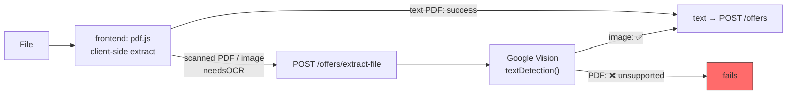
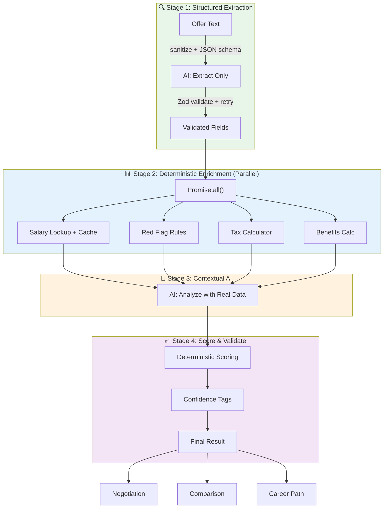
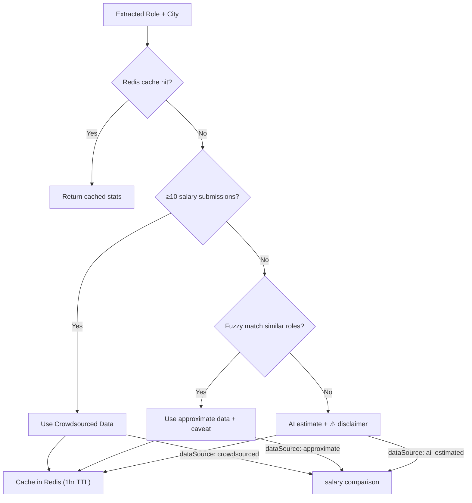
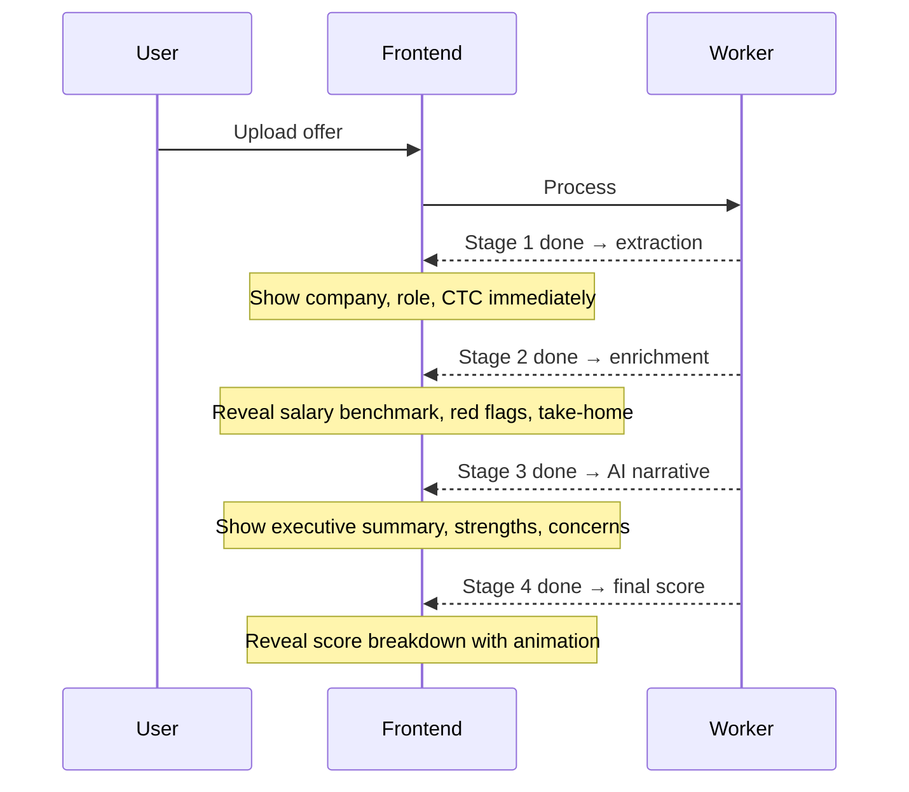

# PLAN: Reliable Analysis Pipeline (All Features)

> **Problem**: The system sends raw offer text to Gemini AI in a single-pass with a vague prompt and blindly trusts the response. Salary data is fabricated, red flags may be hallucinated, scores are arbitrary. Downstream features (negotiation, comparison, career) inherit these problems.

---

## Verified State (2026-09-09)

This section records what was confirmed by reading and running the code, not inferred from planning docs.

| Check | Result |
|-------|--------|
| `backend`: `tsc --noEmit` | ✅ passes clean |
| `frontend`: `tsc --noEmit -p tsconfig.app.json` | ✅ passes clean |
| `frontend`: `npm test` | ✅ 1 passed — but the only test is `expect(true).toBe(true)` |
| `backend`: automated tests | ❌ none exist |
| Integration verification | Manual scripts only: `test-m2.mjs`, `test-m3.mjs` |
| Pipeline refactor progress | ❌ not started — worker still single-pass |
| Working tree | clean, `main` synced with origin |

**Manual test script status**: `test-m2-results.txt` shows negotiation, benefits, and corrections all returning `OFFER_NOT_READY`, and comparison skipped, because no analysis reached `COMPLETED` during that run. Those four features have never been exercised end-to-end.

> [!WARNING]
> **`test-m3-results.txt` is partially stale.** Its salary section logs `POST /salaries` → `200 OK`; the current route is `POST /salary` → `201`. It was recorded against an older revision. Forum and career-path sections still match current routes and remain valid evidence. Treat the salary section as no evidence.

**What was NOT verified**: no runtime behaviour. The backend was never booted — that needs Postgres, Redis, a Gemini key, and GCP credentials. Every "works" claim below rests on reading the code plus the two manual logs, not on observed execution.

**Deployment status**: never deployed, no real user data — confirmed by the project owner. All defects below are pre-production with zero live exposure. Note this repo had an earlier life (**v1**, React + Prisma) that *did* reach a `"MVP to Production"` commit with Railway config before being re-initialized into the current Fastify + Drizzle codebase. See ADR-003 for what the rewrite dropped and should recover.

**Frontend bundle baseline**: one **1,465 KB** JS chunk, zero code splitting. Target is 200 KB init + 80 KB/route (ADR-002).

---

## Runtime Verification (2026-09-10)

First time this codebase has been run. Postgres 16 + Redis 7 via the repo's `docker-compose.yml`, real Gemini and Cloud Vision providers, `test-security.mjs` driving the API.

### ✅ Phase -1A verified live — 20/20

`node test-security.mjs` passes every assertion. Each one was previously reasoning only:

| Claim | Result |
|-------|--------|
| `ol_guest` cookie issued on first request, stable across requests | ✅ |
| A second browser gets a **different** identity | ✅ (the original bug) |
| Owning guest can read its own offer | ✅ |
| A different guest gets **404** on offer, analysis, and PDF report | ✅ |
| A caller with no cookie gets **404** | ✅ |
| Identical text from another guest gets its **own** offer ID | ✅ (A3) |
| Guest offer claimed into an account on signup | ✅ |
| The old guest cookie can **no longer** read a claimed offer | ✅ (the `!offer.userId` condition) |
| Another logged-in user **cannot** delete someone's offer | ✅ (was: anyone could) |
| The owner still can | ✅ |

Schema confirmed against the live DB: the global `text_hash` unique constraint is gone, both composite indexes exist. **`db:migrate` from empty produces a correct schema**, so the migration chain does work — one input to the C11 decision.

Also verified: the Phase 1 task 0 model fix works. Workers ran on `gemini-2.5-flash` with no 503 and no fallback needed.

### 🔴 The analysis pipeline is worse than the audit inferred

The audit said output was "unvalidated". Running it shows the output is **entirely discarded**, and the failure is silent.

A deliberately red-flag-heavy offer letter (non-compete, IP assignment, termination-without-notice, 90-day notice) produced:

```
score = 70   score_label = 'fair'   scoring_method = 'standard'
extracted_data = {}          red_flags = []      red_flags_discarded = 0
ai_metadata = { modelUsed: 'unknown', processingNote: 'Metadata missing from AI response' }
```

**Gemini was not at fault.** Replaying the app's exact `buildPrompt()` shows the model extracted everything correctly — company name, role, location, ₹24,00,000 CTC, and it *did* catch the non-compete with a severity and a recommendation. It simply returned its own key names:

| Gemini returned | Code reads (`normalizeAiResult`) |
|---|---|
| `company_name`, `role`, `location` | `extractedData` |
| `red_flags` | `redFlags` |
| `salary` | `salaryComparison` |
| `summary` | *(nothing reads this)* |
| — | `negotiationSuggestions`, `takeHome`, `metadata` — all absent |

Only `benefits` matched, by luck of the name. Everything else fell through to `|| {}` / `|| []`.

This is the direct consequence of the prompt never containing the schema. **Confirms Phase 1 tasks 3-5 as the highest-value work in this plan**: the extraction quality is already there and is being thrown away.

Worse than a crash: the offer is marked `COMPLETED` and the user is shown a confident **70/100 "fair"** derived from nothing at all. The score is the `70` baseline with no adjustment, because there were no flags and no percentile to adjust with.

### 🔴 Two more contract breaks on the results path

Found while tracing why the score read `n/a`:

**The API never returns the score.** The worker computes and stores `score` and `scoreLabel`, but `AnalysisService.getAnalysis()` returns only `extractedData`, `redFlags`, `salaryComparison`, `negotiationSuggestions`, `benefits`, `takeHome`, `metadata`. The product's headline number never leaves the database.

**`ResultsPage` reads a third, different shape.** There is no adapter — `const a = analysis` is the raw response. It reads flat fields the API does not send:

| ResultsPage reads | API actually sends | Effect |
|---|---|---|
| `a.score`, `a.scoreMethod` | *(not returned)* | Gauge renders **0** |
| `a.company`, `a.role`, `a.location` | nested in `extractedData` | Header shows literal "Company" / "Role" |
| `a.negotiationTips` | `negotiationSuggestions` | `a.negotiationTips.map(...)` is **unguarded → the page throws** |
| `a.redFlags`, `a.benefits` | same names | ✅ work |

So the main results screen currently cannot render a completed analysis. Add to **-1B** as B6 — same bug class as B1/B2, and the contract test in B4 would not catch it because it only checks route existence, not response shape.

### 🟡 Smaller runtime notes

- `POST /offers` is **multipart-only**. The route walks `req.body` for `{ type: 'file' | 'field' }` objects, so a JSON client gets a misleading `"File or text is required"` 400. Worth accepting JSON or documenting it.
- `db:push` **hangs** on an interactive confirmation because `drizzle.config.ts` sets `strict: true`. Use `db:migrate` in scripts, or pass `--force`.
- `docker-compose.yml` warns that the `version:` attribute is obsolete. Harmless, one line to delete.

**Already implemented from this plan**: the red-flag hallucination guard is live in `analysis.worker.ts` — flags whose `matchedText` is absent from the raw text are discarded and counted in `redFlagsDiscarded`. Nothing else below has been started.

---

## Current System Audit

### Core Analysis Pipeline


| Problem | Where | Impact |
|---------|-------|--------|
| Prompt never contains the schema | `gemini.ai.ts` → `buildPrompt()` ends with "Output compliant JSON matching the AnalysisResult interface." The interface is never included in the prompt text | The model is asked to conform to a TypeScript type it has never seen |
| `responseSchema` not set | `gemini.ai.ts` sets `responseMimeType: 'application/json'` only | The sole structural guarantee is "it is JSON" |
| No validation of AI output | `normalizeAiResult()` in `analysis.worker.ts` coerces whatever arrives into shape with defaults. No Zod anywhere on the response path | A garbage response becomes a confident-looking analysis |
| No retry on malformed JSON | `JSON.parse` failure is not a rate-limit error, so `withFallback()` rethrows immediately | Contradicts roadmap's "retry once with a stricter prompt" |
| **Fallback chain never engages on 503** | `isRateLimitError()` matches only 429 / quota / rate limit / RESOURCE_EXHAUSTED. Google returns **503 Service Unavailable** when a model is overloaded, so `withFallback()` throws instead of trying the next model | **Verified live 2026-09-09**: the default model `gemini-flash-latest` returned 503 while two configured fallbacks answered fine. Every analysis fails outright whenever the default is busy — the exact scenario the fallback list exists for |
| **Half the fallback model list is invalid** | 3 of the 6 entries in `GEMINI_FALLBACK_MODELS` are unusable | **Verified live**: `gemini-2.0-flash` and `gemini-2.0-flash-lite` are absent from ListModels; `gemini-2.5-flash-lite` is listed but 404s on `generateContent`. Only `gemini-2.5-flash` and `gemini-flash-lite-latest` actually work, plus `gemini-flash-latest` when not overloaded |
| Salary data hallucinated | `salaryComparison` always `ai_estimated` | Users make career decisions on fabricated numbers |
| Crowdsourced salary DB exists but is never used | `SalaryService.getStats()` is functional, never called by the worker. Threshold is `data.length < 5`, not 10 | Real data wasted |
| Score formula is trivial | `70 base ± flags ± percentile`, `analysis.worker.ts` | Doesn't reflect actual offer quality |
| Red flag detection is AI-only | No rules engine | Misses obvious flags, invents others |
| No confidence signals | `lowConfidence` is hardcoded `false` when the analysis row is inserted | Users can't tell what's reliable vs guessed |
| Author's scratch reasoning left in source | ~25 lines of unresolved stream-of-consciousness comments above the scoring block in `analysis.worker.ts` | Obscures intent for the next reader |
| `processingTimeMs` is wrong | Computed as `Date.now() - offer.updatedAt`, which is not job start time | Metric is meaningless |

### Feature-Level Problems

| Feature | Current Approach | Problem |
|---------|-----------------|---------|
| **Salary Comparison** | AI fabricates `p25/p50/p75/p90` from training data | 100% hallucinated. `SalaryService` with crowdsourced data exists but is never connected |
| **Negotiation Script** | Feeds AI-hallucinated `salaryComparison` into negotiation prompt | Garbage-in-garbage-out — negotiation points based on fake market data |
| **Benefits Valuation** | ⚠️ **Corrected assessment.** `benefits.calculator.ts` structures benefits and does PTO × daily-rate math, but `extractNumber()` strips currency symbols and takes the first number with **no unit handling** | "₹5 lakh" → `5`. "₹2.5L" → `2.5`. "10 LPA" → `10`. Monetary values can be wrong by 5-6 orders of magnitude, and they feed `totalCompensation`. Also grabs the low end of ranges ("18-24 days" → `18`) |
| **Offer Comparison** | Deterministic ranking by score/flags/percentile | Good structure, but all inputs (score, percentile) are AI-fabricated |
| **Career Path** | Calls `ai.generateCareerPath()` with hardcoded `industry: 'Technology'`, `companyType: 'Unknown'` | No real context. Completely generic AI generation |
| **Take-Home Estimate** | AI guesses monthly take-home with "assumptions" | Should be deterministic tax math, not AI speculation |

---

## Defects Outside the Pipeline

> This plan was originally scoped to AI accuracy only. A code-level pass surfaced a separate class of defect — authorization, guest identity, rate limiting, and dead code paths — that blocks launch independently of pipeline quality. These are **not** fixed by the multi-stage refactor and need their own phase.

### 🔴 P0 — Guest identity collapses across users

**The frontend never sends `X-Fingerprint`.** Zero occurrences in all of `frontend/src`. So `middleware/guest-identifier.ts` always falls through to:

```ts
const fallbackFingerprint = CryptoJS.MD5(`${ip}-${userAgent}`).toString();
```

Every visitor sharing an IP and User-Agent becomes one guest identity. Two consequences, neither requiring an attacker:

1. **Shared quota** — the 3-analyses-per-day guest limit is per IP+UA, so an office or campus network gets 3 total, not 3 each.
2. **Cross-user data leak** — `AuthService.migrateGuestOffers(fingerprint, userId)` matches guest offers by that fingerprint. On signup a user **inherits strangers' offer letters** (salary, company, name) if they shared an IP and browser. This is in the guest→account funnel, which is the product's primary conversion path.
3. **Feature-request voting is one vote per network** — `feature-request.routes.ts` passes `req.guestId` as the dedup key for `service.vote()`, so the second person behind a NAT cannot vote. Same for `create()`. This quietly breaks M7's whole premise of "the product evolves based on user demand," because the vote counts measure networks, not people.

Side effect: the spoofing detector can never fire (one fingerprint per IP, threshold is 5), so that code is inert.

**Fix options**: send a real client-generated fingerprint, or drop fingerprint-based migration in favour of a signed guest cookie.

### 🔴 P0 — Missing ownership checks

Ownership enforcement is **correct** in `negotiation`, `benefits`, `comparison`, `correction`, and `career` — all check `offer.userId !== userId` and 403. The gaps are concentrated in the offer and analysis routes:

| Endpoint | Current | Problem |
|----------|---------|---------|
| `DELETE /offers/:id` | `requireRegistered`, no ownership check | **Any logged-in user can delete any other user's offer by ID.** `OfferService.delete()` only verifies existence |
| `GET /offers/:id` | no auth, no ownership | Returns `rawText` — the full offer letter |
| `GET /offers/:id/analysis` | no auth, no ownership | Full analysis exposed by ID |
| `GET /offers/:id/report` | no auth, no ownership | Roadmap specified registered-only (`GUEST_RESTRICTED`); it is fully open |

Root cause: `requireRegistered` in `middleware/authenticate.ts` proves *authentication* and never *ownership*. Fix it in one guard rather than per-route.

Compounding this: `offers.textHash` is `.unique()` **globally**, and `OfferService.create()` returns the existing offer's ID on a hash hit. Identical text from a different person hands you their offer ID, which the unauthenticated GETs then serve. Dedup should be scoped per user/guest.

### 🔴 P0 — Frontend↔backend contract drift: Salary Explorer is non-functional

The Salary Explorer page fails on **three independent mismatches** against the same feature:

| Layer | Frontend sends | Backend expects | Result |
|-------|----------------|-----------------|--------|
| Path | `POST /salaries` and `GET /salaries/stats` (`constants/api.ts`) | `POST /salary`, `GET /salary` (`salary.routes.ts`) | **404** |
| Payload field | `annualCtc` | `ctc` | NOT NULL violation |
| Payload field | *(omitted entirely)* | `companyType` is `.notNull()` | NOT NULL violation |

So the crowdsourced salary DB cannot be populated through the UI at all — which compounds the Stage 2a problem: even after the analysis worker is wired to `SalaryService.getStats()`, there will be no data to read.

> [!WARNING]
> **`test-m3-results.txt` is stale and must not be trusted as evidence.** It logs `POST /salaries` → `200 OK`. The current route is `POST /salary` and returns `201`. That log was recorded against an older revision. Its forum and career-path sections still match current routes; its salary section is worthless.
>
> This is a second-order finding worth noting on its own: **the only runtime evidence this project has is two uncommitted, unversioned, manually-run scripts, and one of them has already silently gone out of date.** That is the strongest argument for Phase 0.

**Also dead**: `OFFER_ANALYZE: (id) => /offers/${id}/analyze` is defined in `constants/api.ts`. No such backend route exists. Currently unused, so harmless — but it is a live trap for the next person.

### 🟠 P1 — Experience level has three incompatible vocabularies

| Source | Values |
|--------|--------|
| `frontend/src/constants/api.ts` → `EXPERIENCE_LEVELS` | `"Entry Level"`, `"Mid Level"`, `"Senior"`, `"Lead"`, `"Manager"`, `"Director"`, `"VP"`, `"C-Level"` (8) |
| `backend/src/db/seed.ts` → `EXPERIENCE` | `"Fresher (0-1 yrs)"`, `"Junior (1-3 yrs)"`, `"Mid-Level (3-5 yrs)"`, … (6) |
| `gemini.ai.ts` → `extractMetadata()` prompt | Matches the DB seed (6) |

The AI is instructed to return the DB vocabulary, but the upload form's dropdown offers the frontend's. An auto-filled `experienceLevel` will not match any option the user can select. `GET /metadata/experience-levels` serves the DB values and is apparently not what the form binds to.

Pick one vocabulary — the DB seed is the right source of truth since it carries `minYears`/`maxYears` — and delete the other two.

### 🟠 P1 — Local setup cannot work from a fresh clone

| Problem | Detail |
|---------|--------|
| `.env.example` omits required secrets | `JWT_SECRET` and `JWT_REFRESH_SECRET` are both required at min 32 chars by `env.schema.ts`. Copying `.env.example` produces a config that **fails validation at boot**. `GOOGLE_CLIENT_ID`/`SECRET` are also absent |
| `.env.example` has duplicated keys | `PORT`, `DATABASE_URL`, `REDIS_URL` each appear twice — a sloppy append |
| API port mismatch | Frontend defaults to `http://localhost:5000/api/v1`; backend `PORT` defaults to **8000** |
| CORS origin mismatch | Backend `CORS_ORIGIN` defaults to `http://localhost:3000`; the Vite dev server serves on **8080** |
| `frontend/.env` is committed | Tracked in git, and there is **no `frontend/.env.example`**. Contents are `VITE_API_BASE_URL` + `VITE_GOOGLE_CLIENT_ID`. OAuth web client IDs are public by design, so this is hygiene rather than a credential leak — but the pattern is inverted and should be fixed before anything secret lands there |

Net effect: nothing runs until three separate values are overridden, and the file that is supposed to document them is both incomplete and, in the frontend's case, the wrong file to be tracking.

### 🟠 P1 — Per-route rate limits are dead config

`config/constants.ts` defines 15 per-route limits in `RATE_LIMITS`. `middleware/rate-limiter.ts` registers exactly **one**: `global` at 100/min. Only `guestUpload` is separately enforced, inside `GuestService.checkLimits`.

So `authLogin: { max: 10, window: '15 minutes' }` is unused — login brute-force protection is 100/min, keyed on the IP+UA hash above. Same for `featureRequestCreate`, `negotiate`, `compare`, `corrections`, `benefits`, and the rest.

`POST /offers/extract` (Gemini) and `POST /offers/extract-file` (Google Vision) are **unauthenticated** with only that global limit between an anonymous caller and the GCP bill.

### 🟠 P1 — Path traversal on temp files

`OfferService.extractTextFromFile()` and `extractMetadata()` write ``temp-${uuidv4()}-${file.filename}`` to the process CWD with `file.filename` **unsanitized**.

### 🟠 P1 — Scanned PDFs cannot work

Actual OCR architecture is hybrid, and differs from what earlier docs imply:



`google-vision.ocr.ts` calls `client.textDetection(filePath)`. Vision's `textDetection` **does not accept PDF input** — that requires `asyncBatchAnnotateFiles` with a GCS bucket. Images work; scanned PDFs fail, which is precisely the case the fallback exists to serve.

Because the client-side path covers text PDFs, `ocr.worker.ts`'s Vision branch is largely bypassed in the real flow.

### 🟠 P1 — OCR confidence gate is inert

```ts
const confidence = result.fullTextAnnotation?.pages?.[0]?.confidence || 0.85;
```

A legitimate `0` becomes `0.85`. And when the gate does trip, `ocr.worker.ts` **hard-fails** the offer, where the spec called for `lowConfidence: true` plus an editable-text warning. `analysis.worker.ts` then writes `lowConfidence: false` hardcoded, so the signal never reaches the UI by either route.

### 🟡 P2 — Missing reliability paths from the roadmap

| Roadmap requirement | Status |
|---------------------|--------|
| Stale job reaper (`PROCESSING` > 5 min → `FAILED`) | ❌ Not implemented. `ANALYSIS_TIMEOUT_MS` is defined and never referenced. Stuck offers stay stuck forever |
| Redis-down fallback to synchronous processing | ❌ Not implemented. `ocrQueue.add()` throws |
| Guest TTL purge | ✅ Works. `cleanup.worker.ts` runs hourly; `migrateGuestOffers` correctly nulls `expiresAt` so migrated offers are not purged |

### 🟡 P2 — Smaller items

| Item | Detail |
|------|--------|
| Phantom dependency | `uuid` is imported in `offer.service.ts` and `guest-identifier.ts` but absent from `package.json`. `npm ls uuid` shows it resolving only via `bullmq`. Node 22 has `crypto.randomUUID()` — the dep is unnecessary as well as undeclared |
| Refresh tokens in `localStorage` | `services/api.ts`, 7-day lifetime, against the project's own stated standard of httpOnly cookies |
| pdf.js worker from CDN | `pdf-extractor.ts` loads the worker from `cdn.jsdelivr.net` at runtime. `vite-plugin-static-copy` is installed but absent from `vite.config.ts`, so self-hosting was likely intended |
| TOCTOU on guest limit | `checkLimits` runs before the transaction, `incrementAnalysisCount` inside it. Concurrent uploads can both clear the check |
| `spoofingTracker` memory | Unbounded in-memory `Map` keyed by IP, pruned only on window reset for that IP. Single-instance only |
| Dead code | `ANALYSIS_TIMEOUT_MS` unreferenced; `uuidv4` imported but unused in `guest-identifier.ts`; `vite-plugin-static-copy` unused |
| Duplicated extraction logic | `OfferService` has three near-identical methods (`extractTextFromFile`, `extractMetadata`, `extractMetadataFromText`) with **inconsistent provider gating** — one checks `NODE_ENV === 'production'`, the others don't |

---

## Proposed Architecture: Multi-Stage Pipeline



### Failure Isolation

Each stage produces a result OR a graceful fallback — a single stage failure never blocks the entire pipeline:

| Stage Failure | Fallback | Result |
|---------------|----------|--------|
| Salary lookup fails | AI estimate with `⚠️ AI Estimated` disclaimer | Degraded |
| Rule engine crashes | AI handles all red flag detection | Slightly less reliable |
| Tax calculator fails | Skip take-home section | Core analysis still available |
| Stage 3 AI fails | Return Stage 1 + Stage 2 data without AI narrative | Structured data only |
| Stage 1 extraction fails + retry fails | Fail the job, user can retry with different model | Hard failure |

---

## Stage 1: Structured Extraction (AI → Zod)

**Current**: Single prompt does extraction + analysis + salary comparison + negotiation tips simultaneously.

**Proposed**: Dedicated extraction-only prompt.

- **Sanitize input text** before embedding in prompt — strip control characters, unusual unicode, and prompt-injection patterns
- Use Gemini's **system instruction** (separate from user content) for the extraction schema
- Use Gemini's `responseSchema` parameter to enforce JSON structure at the model level
- Include **2-3 few-shot examples** of annotated extractions for consistency
- Validate output with Zod schema before proceeding
- If validation fails → retry once with validation error feedback
- **Post-extraction sanity checks**: flag suspicious values (CTC > ₹10Cr, CTC < ₹1L for experienced role)
- ~500 tokens per call (fast, cheap)

> [!IMPORTANT]
> **Key principle**: AI extracts what's IN the text. It does NOT analyze, compare, score, or generate salary data. This eliminates hallucination at the source.

**Extracted fields**:
```
├── companyName, role, department, location, industry, companyType
├── compensation (base, variable, equity, components, totalCTC)
├── benefits (name + verbatim value text)
├── dates (joining, offer expiry)
├── terms (notice period, probation, bond, non-compete)
├── restrictive clauses (verbatim quotes)
└── employmentType, currency
```

**Few-shot example structure** (include 2-3 in prompt):
```
EXAMPLE:
Text: "We are pleased to offer you Senior Software Engineer at Infosys, Bangalore. 
       Your annual CTC will be ₹18,00,000..."
Extraction: {"companyName": "Infosys", "role": "Senior Software Engineer", 
             "location": "Bangalore", "compensation": {"totalCTC": 1800000, "currency": "INR"}, ...}
```

---

## Stage 2: Deterministic Enrichment (No AI, Parallel)

All Stage 2 tasks run via **`Promise.all()`** — they're independent and shouldn't block each other.

### 2a. Salary Benchmarking — Real Data

**Current**: AI fabricates `marketRange: { p25, p50, p75, p90 }`.

**Proposed**: Hybrid real data + disclaimer system.



**Implementation details**:
- Wire existing `SalaryService.getStats(role, city)` into analysis worker
- **Fuzzy role matching**: synonym map (`"SDE" ≈ "Software Engineer" ≈ "Software Developer"`)
- **Experience-level filtering**: filter salary submissions by experience bracket, not just role+city
- **Redis caching**: `salary:{role}:{city}` key, 1-hour TTL
- **Minimum sample size**: `n ≥ 10` (raised from 5 for noise resistance)
- Add `dataSource` + `sampleSize` + `dataRecency` fields for UI transparency
- Seed DB with public salary data for bootstrapping

**Data integrity protections**:
- **Statistical outlier detection**: reject submissions >3σ from mean for that role/city
- **Recency weighting**: `weight = 1 / (1 + monthsOld × 0.1)` — older data counts less
- Consider requiring **email verification** for salary submissions

---

### 2b. Red Flag Rule Engine

**Current**: AI decides what's a red flag. May miss obvious ones or hallucinate non-existent ones.

**Proposed**: Pattern-based rules + AI supplement.

| Rule | Pattern | Severity | Type |
|------|---------|----------|------|
| Non-compete | `non-compete`, `restrictive covenant`, `not engage in` | high | `non_compete` |
| Service bond | `bond`, `minimum service`, `lock-in period`, `training cost recovery` | high | `bond` |
| Clawback | `clawback`, `repayment`, `recovery of`, `return of` | high | `clawback` |
| Broad IP assignment | `all intellectual property`, `assign to company`, `work product` | medium | `ip_assignment` |
| Vague compensation | `at discretion`, `may include`, `subject to`, `up to` | medium | `vague_compensation` |
| Probation risk | `terminated without notice during probation` | medium | `probation` |
| At-will clause | `at-will`, `terminate at any time` | low | `other` |
| Missing health insurance | Absence of `health`, `medical`, `insurance` | medium | `missing_benefit` |
| Missing PF/retirement | Absence of `provident fund`, `PF`, `retirement` | low | `missing_benefit` |

- Each rule-flagged issue tagged `source: "rule"` (deterministic)
- AI can still find nuanced issues, tagged `source: "ai"` (with lower confidence)
- UI shows source badge for transparency
- **Prefer `String.includes()` over regex** to avoid ReDoS — use regex only for complex patterns
- **100ms execution timeout** as safety net

---

### 2c. Take-Home Calculator (Indian Tax Regime)

**Current**: AI guesses "monthly take-home: approximately ₹X with assumptions."

**Proposed**: Deterministic calculator for Indian salaries.

| Component | Calculation |
|-----------|-------------|
| Basic salary | From extracted data or 40% of CTC (typical) |
| HRA exemption | min(actual HRA, 50%/40% of basic, rent - 10% of basic) |
| Standard deduction | ₹50,000 |
| EPF employee contribution | 12% of basic (capped at ₹15,000/month) |
| Professional tax | ~₹200/month (state-dependent) |
| Tax (new regime) | Slab-based calculation |
| Tax (old regime) | Slab-based with Section 80C, 80D deductions |

**Output**: Both old and new regime take-home comparisons with breakdown.

---

### 2d. Benefits Calculator (Existing — Enhance)

**Current**: `benefits.calculator.ts` does PTO valuation, insurance detection, and equity categorization — the *structure* is sound. The *numbers* are not: `extractNumber()` is unit-blind (see the corrected row in Feature-Level Problems above).

**Enhancements**:
- **Fix `extractNumber()` first** — handle lakh / L / LPA / Cr / crore multipliers, and decide range policy (take the low end, or return a range). This is a prerequisite, not an enhancement
- Add a **standard benefits checklist** (health insurance, PF, gratuity, leave encashment, WFH allowance, learning budget) — flag missing ones
- Add **industry-standard comparison** (e.g., "most product companies offer 18-24 days PTO, your offer has 12")
- Connect `BenefitBreakdown` totals into the scoring rubric

---

## Stage 3: Contextual AI Analysis

**Current**: AI does everything from scratch with no data.

**Proposed**: AI receives Stage 1 + Stage 2 outputs as context.

The AI prompt now says:
```
SYSTEM INSTRUCTION (separate from user content):
You are an expert compensation analyst. Analyze the following pre-extracted 
and enriched offer data. Do NOT re-extract or invent data — use what's provided.

USER CONTENT:
Here is the extracted offer data (verified from the text):
{extractedData}

Here is the salary benchmark for {role} in {city}:
{salaryComparison — source: crowdsourced/approximate/ai_estimated}

Here are the red flags identified by our rule engine:
{ruleEngineFlags}

Here is the tax-calculated take-home:
{takeHomeBreakdown}

Provide:
1. Executive summary (2-3 sentences)
2. Strengths of this offer
3. Concerns and negotiation leverage points
4. Any additional soft red flags the rules might have missed
5. Industry context for the compensation package
```

**Key design decisions**:
- AI is an *analyst commenting on real data*, not the *data source*
- **Do NOT re-send raw offer text** — only the structured extraction. Saves ~50% tokens
- Use Gemini **system instruction** to isolate analysis instructions from data (prompt injection defense)
- **Token budget**: max ~4K tokens input to Stage 3 (structured data is compact)

### Prompt Versioning

Store prompt template versions in `analysis.aiMetadata` for rollback and A/B testing:

```json
{
  "extractionPromptVersion": "v1.2",
  "analysisPromptVersion": "v1.0",
  "modelUsed": "gemini-2.5-flash",
  "totalTokensUsed": 3847
}
```

---

## Stage 4: Scoring & Validation

### Deterministic Scoring Rubric

**Current**: `score = 70 ± (flags × severity) ± (percentile bump)` — arbitrary.

**Proposed**:

Weights set by decision 7. Revised from an earlier 35/25/20/10/10, which put the largest weight on the least reliable input.

| Component | Weight | Calculation |
|-----------|--------|-------------|
| **Red Flag Penalty** | 30% | 100 base, deduct per flag: High −20, Med −10, Low −5. Weighted highest because rule-engine flags are the most deterministic signal available |
| **Salary Position** | 30% | `offerPercentile` from real salary data → 0-100 |
| **Benefits Completeness** | 20% | % of standard benefits present from checklist |
| **Growth Signals** | 10% | Equity/ESOP, learning budget, title progression, RSU |
| **Transparency** | 10% | Compensation breakdown clarity, no vague terms |

**Redistribution rule** (roadmap M3 sad path, currently unimplemented): when salary benchmark data is unavailable, the 30% salary weight is redistributed proportionally across the remaining four components, and the response carries `"Score based on limited market data"`. Until Phase 1 wires in real salary data and Phase 4 seeds the DB, this is the *default* path, not the exception.

### Confidence Tagging

| Level | Meaning | UI Treatment |
|-------|---------|-------------|
| `high` | Verbatim from offer text | Normal |
| `medium` | AI-inferred from context | 🟡 tag |
| `low` | AI-estimated, no evidence | 🟠 "AI Estimate" badge |
| `unverified` | No ground truth available | 🔴 disclaimer |

---

## Progressive UX (Frontend)

With 4 stages, processing takes longer. Instead of hiding behind a spinner, **stream partial results** as each stage completes:



**Implementation options** (pick one):
- **Option A**: SSE (Server-Sent Events) for real-time stage updates
- **Option B**: Polling `GET /offers/:id` returns `{ stage: 2, partialResults: {...} }`
- **Option C**: Store stage results in DB progressively, frontend polls and renders as data arrives

Option B is simplest and works with existing polling architecture.

---

## Feature Improvements

### 🔄 Salary Comparison (Explorer Page)

| Change | Detail |
|--------|--------|
| **Wire into analysis pipeline** | Analysis worker calls `SalaryService.getStats()` at Stage 2a |
| **Fuzzy role matching** | Synonym map: `"SDE" ≈ "Software Engineer" ≈ "Software Developer"` |
| **Experience-level filtering** | Filter salary submissions by experience bracket, not just role+city |
| **Data quality indicators** | Show sample size (`n=47`) and data recency ("last 6 months") in UI |
| **Seed with public data** | One-time import from public salary datasets to bootstrap |
| **User contribution prompt** | After analysis, ask user to submit their salary anonymously to grow the DB |

---

### 📝 Negotiation Script

| Change | Detail |
|--------|--------|
| **Use real market data** | Pass the real salary benchmark (from Stage 2a) into the prompt |
| **Structured negotiation points** | Rule-engine flags become specific, defensible talking points |
| **Template library** | Pre-built templates for common scenarios (counter-offer, competing offer, relocation) |
| **Tone calibration** | AI receives specific instructions per tone: professional=formal, assertive=data-heavy, friendly=collaborative |
| **Output validation** | Validate script has: greeting, acknowledgment, specific asks with numbers, professional close |
| **Editable output** | Frontend: rich-text editor so user can tweak before sending |

---

### 🏆 Offer Comparison

| Change | Detail |
|--------|--------|
| **Real scores** | Comparison uses deterministic rubric scores (Stage 4), not AI-generated |
| **Dimension-by-dimension breakdown** | Show comparison across each scoring component (salary, benefits, flags, growth, transparency) |
| **AI-generated comparison narrative** | "If you value X, go with Offer A; if you value Y, go with Offer B" |
| **Visual radar chart** | Frontend: radar/spider chart comparing offers across 5 dimensions |
| **Weighted preferences** | Let user set priorities ("salary matters most" vs "benefits matter most") → re-rank |

---

### 🎯 Career Path

| Change | Detail |
|--------|--------|
| **Extract industry + company type** | Stage 1 extraction includes `industry` and `companyType` fields |
| **Company-specific context** | If company is known (e.g., Google, TCS), AI uses company-specific career ladders |
| **Salary progression with real data** | Year 1/3/5 salary ranges from crowdsourced DB filtered by experience level |
| **Skills-to-learn grounded in reality** | AI generates based on actual job market trends, not generic lists |

---

### 💰 Benefits Valuation

| Change | Detail |
|--------|--------|
| **Standard benefits checklist** | Define expected benefits per industry/company-type. Flag missing ones. |
| **Industry comparison** | "Most product companies offer X. Your offer includes/misses Y" |
| **Total comp visualization** | Frontend: stacked bar chart (base + variable + benefits + equity) |
| **User overrides** | Already supported (`overrides` param) — expose in UI |

---

### 💸 Take-Home Calculator (NEW)

| Feature | Detail |
|---------|--------|
| Indian tax calculation | Old vs new regime comparison |
| EPF contribution | Employee + employer |
| HRA exemption | Location-based (metro vs non-metro) |
| Professional tax | State-based |
| Monthly breakdown | Gross → deductions → net |
| What-if scenarios | "What if you negotiate ₹2L more base?" → instant re-calc |

---

## Implementation Phases

### Phase -1: Correctness & Security — Blocks Launch

Split into three independently reviewable units. Each is commit-sized and safe to stop after. Originally scoped as "1-2 days" for 9 tasks; it is now 23 across three groups, so treat the estimate per-group rather than as a whole.

Ordering rationale: **-1A** fixes the defects that corrupt data. **-1B** fixes the ones that make features silently non-functional. **-1C** is hardening and tooling, none of which changes behaviour a user sees.

---

#### -1A — P0 Security (ADR-001)

The only group that touches data integrity. Do this first and in order; A2 depends on A1's identity model.

| # | Task | Severity | Status |
|---|------|----------|--------|
| A0 | Stand up vitest on the backend — prerequisite for leaving a runnable check behind on A1-A4 | 🟠 P1 | ✅ `vitest.config.ts`, tests colocated as `src/**/*.test.ts` so `tsc` covers them |
| A1 | Add `@fastify/cookie`; issue a signed httpOnly guest cookie on first request. Remove `X-Fingerprint`, the `MD5(ip+ua)` fallback, `spoofingTracker`, and the spoofing-detection path. Drop `X-Fingerprint` from CORS `allowedHeaders`; add `withCredentials` on the frontend | 🔴 P0 | ✅ Done |
| A2 | Build one `assertOfferAccess(offer, req)` guard (`userId` match OR guest match). Apply to `GET`/`DELETE /offers/:id`, `/analysis`, `/report`, and **replace** the five duplicated checks in negotiation, benefits, comparison, correction, career | 🔴 P0 | ✅ Done |
| A3 | Scope `textHash` dedup per user/guest instead of globally — needs a schema migration to drop the global unique constraint | 🔴 P0 | ✅ Done — migration `0001` |
| A4 | Track created offer IDs client-side; signup presents them and the server migrates only those, after verifying guest ownership. Also fixes guests losing their analysis on tab close | 🔴 P0 | ✅ Done |

**Verified**: `tsc --noEmit` clean on both packages; 22 backend tests pass across 3 files.

**What the tests cover**: the two decision points, as pure functions — `canAccessOffer` (owner, wrong user, owning guest, wrong guest, anonymous, post-migration guest, orphan, empty-string identities) and `resolveGuestToken` / `resolveDedupScope`. **Not covered**: anything requiring a live Postgres or Redis, so the DB-facing wrappers (`loadAuthorizedOffer`, `migrateGuestOffers`) and Fastify hook ordering are reasoned-about but not executed. Those need the integration suite.

**Notable implementation choices**

| Choice | Reason |
|--------|--------|
| Guard raises **404, not 403** | A 403 on an existing offer confirms the ID is real, making the endpoint an enumeration oracle. Changes behaviour vs the old per-service 403s |
| Guest branch requires `!offer.userId` | `migrateGuestOffers` sets `userId` but leaves `guestId` populated. Without this, an old guest cookie would retain access to a claimed offer |
| `request.guestId` stays the raw cookie token | The rate limiter's `keyGenerator` reads it directly. The guard resolves token → `guests.id` only when the user path has already failed, so logged-in requests cost no extra query |
| `guests.fingerprint` column kept as-is | It now holds the opaque cookie token. Renaming it would mean a migration for no functional gain |
| `offerIds` on signup is optional | When present it narrows the claim set; when absent all of the guest's offers are claimed. Both are safe now that identity is a signed cookie — the list is defence in depth, not the control |
| Cookie is `sameSite: 'lax'` | Covers same-site deployments including differing localhost ports. Flagged in-code with a `ponytail:` comment: genuinely cross-domain deployment needs `'none'` + `secure` |

#### -1B — Contract integrity

Three currently-broken or latent frontend↔backend mismatches, plus the test that stops the next one.

| # | Task | Severity |
|---|------|----------|
| B1 | **Salary contract**: align the path (`/salaries` vs `/salary`), rename `annualCtc`→`ctc`, send `companyType`. Without this the crowdsourced DB can never fill up, which blocks Stage 2a from ever having data | 🔴 P0 |
| B2 | Collapse the three experience-level vocabularies down to the DB seed; bind the upload form to `GET /metadata/experience-levels` | 🟠 P1 |
| B3 | Delete the dead `OFFER_ANALYZE` endpoint constant | 🟡 P2 |
| B4 | **Contract test**: assert every `ENDPOINTS` entry resolves to a registered Fastify route. Note this checks *paths only* — it would not have caught B6, where the path is right and the response shape is wrong. Consider asserting response keys too | 🟠 P1 |
| B5 | **Update `test-m2.mjs` / `test-m3.mjs` for cookie identity.** Both send `x-fingerprint` and keep no cookie jar, so after A1 every request looks like a brand-new guest. Guest read-back and signup migration will fail in these scripts — a harness problem, not an app problem. Also fix the stale `/salaries` paths and the 200-vs-201 assertion. **Partly superseded**: `test-security.mjs` now covers the guest/auth paths properly with a cookie jar and can be copied from | 🟠 P1 |
| B6 | **Fix the results-path contract** (found live, see Runtime Verification). Return `score` + `scoreLabel` from `AnalysisService.getAnalysis()`, and reconcile `ResultsPage`'s flat field reads (`a.company`, `a.role`, `a.location`, `a.negotiationTips`) against the API's nested `extractedData` and `negotiationSuggestions`. `a.negotiationTips.map()` is unguarded, so the main results screen currently throws on a completed analysis | 🔴 P0 |

> [!TIP]
> B1, B2, and B3 are all the same bug class — `constants/api.ts` and the route definitions drifted with nothing watching. B4 would have caught all three and is cheaper than fixing them one at a time as they surface. That is why it is in this group rather than deferred.

#### -1C — Hardening & tooling

No user-visible behaviour change. Safe to defer past -1A/-1B if needed.

| # | Task | Severity |
|---|------|----------|
| C1 | Wire the per-route `RATE_LIMITS` that already exist, starting with `authLogin`. **[ADR-003]** No regression risk — v1 disabled these for local testing convenience, not because of an incident | 🟠 P1 |
| C2 | Gate `POST /offers/extract` and `/extract-file` behind auth or a strict limit | 🟠 P1 |
| C3 | Sanitize `file.filename` before temp-file writes | 🟠 P1 |
| C4 | Fix the benefits `extractNumber()` unit handling (lakh / L / LPA / Cr) | 🟠 P1 |
| C5 | Fix `.env.example` (add JWT secrets, drop duplicate keys), align the frontend API port default with 8000 and `CORS_ORIGIN` with 8080, add `frontend/.env.example` and gitignore `frontend/.env` | 🟠 P1 |
| C6 | Declare `uuid` in `package.json`, or switch to `crypto.randomUUID()` | 🟡 P2 |
| C7 | **[ADR-003]** Rewrite or delete `.github/workflows/ci.yml` — a stale v1 artifact targeting Prisma and the old directory names; cannot pass | 🟠 P1 |
| C8 | **[ADR-003]** Recover v1's input sanitization module from commit `83a456a` instead of writing it fresh in Phase 1 | 🟠 P1 |
| C9 | **[ADR-003]** Restore ESLint + Prettier — `lint` is currently only `tsc --noEmit` | 🟡 P2 |
| C10 | **[decision 11]** Split `pdfjs-dist`, `recharts`, and `framer-motion` into dynamic imports — 1,465 KB single chunk against a 200 KB budget (ADR-002) | 🟠 P1 |
| C11 | **Decide the migration workflow.** Found while generating A3's migration: the Drizzle journal was badly out of date — snapshot `0000` predates the entire M2/M3 schema, so `0001` had to create `users`, `refresh_tokens`, `corrections`, `forum_posts`, `forum_comments`, `salary_submissions` and add `offers.user_id` alongside the dedup change. That means the schema has been evolving via `db:push` while `db:migrate` sat unused. Pick one: either commit to generated migrations (and accept that `0001` is a large catch-up), or drop the migration files and standardise on `push` for pre-launch. Mixing the two is how a deploy discovers a missing column | 🟠 P1 |

### Phase 0: Evaluation Framework (1 day) — Do This First

| # | Task | Why |
|---|------|-----|
| 0a | Collect 15-20 anonymized offer letters as test corpus | Can't improve what you can't measure |
| 0b | Manually annotate ground truth (company, role, CTC, benefits, red flags) | Baseline for accuracy comparison |
| 0c | Build test harness: run extraction → compare vs ground truth → report field-level accuracy | Tracks regression on every change |

**Target metrics**:
- Structured fields (company, role, CTC): > 90% accuracy
- Nuanced fields (benefits, clauses): > 75% accuracy

### Phase 1: Quick Wins (1-2 days)

| # | Task | Impact |
|---|------|--------|
| 0 | **Fix `isRateLimitError` to treat 503/UNAVAILABLE (and 500) as retryable, and prune the 3 dead entries from `GEMINI_FALLBACK_MODELS`.** Verified live: the default model 503s while working fallbacks sit unused, so analysis fails whenever the default is busy. Smallest high-impact fix in the whole plan — do it first | Analysis stops failing on transient overload |
| 1 | Add prompt-injection sanitization for AI input (strip control chars, injection patterns). **Note**: general XSS/SQLi sanitization is recovered separately in task -1p from v1's commit `83a456a` — this task is only the AI-prompt-specific layer | Security |
| 2 | Wire `SalaryService.getStats()` into analysis worker | Real salary data |
| 3 | Add `responseSchema` to Gemini extraction call | Consistent JSON output |
| 4 | Add Zod validation on AI output in worker | Catch malformed responses |
| 5 | Split `buildPrompt()` into extraction vs analysis + few-shot examples | Better accuracy |
| 6 | Pass real salary data into negotiation prompt | Authentic negotiation points |
| 7 | Extract `industry` + `companyType` in Stage 1 | Fix career path context |

### Phase 2: Rule Engine + Tax Calculator (2-3 days)

| # | Task | Impact |
|---|------|--------|
| 8 | Build red flag pattern rule engine (includes > regex, 100ms timeout) | Reliable, deterministic detection |
| 9 | Build Indian tax take-home calculator | Accurate take-home |
| 10 | Implement weighted scoring rubric — **30 flags / 30 salary / 20 benefits / 10 growth / 10 transparency** per decision 7, with redistribution when salary data is absent | Fair, auditable scores |
| 11 | Add confidence tags to all output fields | User trust signals |
| 12 | Add standard benefits checklist + missing detection | Complete benefits analysis |
| 13 | Add salary data caching in Redis (1hr TTL) | Performance |

### Phase 3: Full Pipeline Refactor (2-3 days)

| # | Task | Impact |
|---|------|--------|
| 14 | Refactor worker into 4-stage pipeline with `Promise.all()` Stage 2 | Separation of concerns |
| 15 | Add partial failure fallbacks per stage | Reliability |
| 16 | Stage 3: Contextual AI via system instruction (no raw text re-send) | Grounded + secure |
| 17 | Add prompt versioning to `aiMetadata` | Rollback + A/B testing |
| 18 | Progressive results: store stage outputs, poll returns partial data | UX during longer processing |
| 19 | Update comparison to use rubric sub-scores | Dimension-by-dimension |
| 20 | Enhance career path with real context + salary progression | Realistic trajectories |
| 21 | Add negotiation template library | Non-AI fallback |
| 21a | Stale job reaper — `PROCESSING` > 5 min → `FAILED` (use the existing `ANALYSIS_TIMEOUT_MS`) | Stuck offers currently never recover |
| 21b | Redis-down fallback to synchronous processing | Roadmap requirement, not implemented |
| 21c | Scanned-PDF OCR via `asyncBatchAnnotateFiles` + GCS, or a different provider | Scanned PDFs currently fail outright |
| 21d | Make the OCR confidence signal real: drop the `\|\| 0.85` default, surface `lowConfidence` instead of hard-failing | Confidence gate is currently inert end-to-end |
| 21e | Consolidate `OfferService`'s three duplicate extraction methods into one with consistent provider gating | Removes divergent `NODE_ENV` behaviour |

### Phase 4: Data Flywheel (Ongoing)

| # | Task | Impact |
|---|------|--------|
| 22 | Add fuzzy role matching (synonym map) | Better salary matches |
| 23 | Seed salary DB with public datasets | Bootstrap benchmarks |
| 24 | Salary data poisoning protection (3σ outlier rejection, recency weighting) | Data integrity |
| 25 | Post-analysis salary contribution prompt | Grow crowdsourced data |
| 26 | User correction loop → improve extraction rules | Self-improving system |
| 27 | PII redaction + 90-day raw text retention policy | Compliance |

---

## Before vs After Comparison

| Feature | Before (Current) | After (Proposed) |
|---------|-------------------|------------------|
| **Extraction** | Single mega-prompt, AI guesses schema | Dedicated prompt + `responseSchema` + Zod + few-shot examples |
| **Salary Comparison** | AI hallucinated p25/p50/p75/p90 | Crowdsourced DB → fuzzy match → AI fallback with disclaimer |
| **Red Flags** | AI-only, may hallucinate | Rule engine + AI for nuance, source-tagged |
| **Take-Home** | AI estimated | Deterministic Indian tax calculator (old + new regime) |
| **Score** | `70 ± adjustments` | 5-component weighted rubric (30/30/20/10/10), auditable, with redistribution when salary data is absent |
| **Negotiation** | AI script based on fake salary data | AI script grounded in real market data + rule-engine talking points |
| **Comparison** | Deterministic but AI-sourced inputs | Real scores, dimension-by-dimension, weighted preferences |
| **Career Path** | `industry: 'Technology'`, hardcoded | Extracted industry + company context + real salary progression |
| **Benefits** | Deterministic structure, but unit-blind number parsing (₹5 lakh → `5`) | Unit-aware parsing + standard checklist, industry comparison |
| **Confidence** | None | Per-field confidence with 4 levels + UI badges |
| **Prompt security** | Raw text in prompt | Input sanitization, system instruction isolation, sanity checks |
| **Failure** | All or nothing | Per-stage fallback, partial results |
| **Measurement** | None | Test corpus + field-level accuracy tracking |
| **Authorization** | Ownership enforced on 5 feature modules; absent on offer read/delete/report | Single guard covering ownership for every offer-scoped route |
| **Guest identity** | Collapses to MD5(IP + User-Agent) — quota and migration shared across users | Per-browser identity, no cross-user inheritance |
| **Rate limiting** | One global 100/min; 15 per-route limits defined but unused | Per-route limits actually registered |

---

## Decisions Made

> Decided 2026-09-09. The three architecturally significant decisions are recorded as ADRs; the rest are in the decision log below.

---

### ADR-001: Guest identity via signed httpOnly cookie

**Status**: Accepted

**Context**

Guest identity currently collapses to `MD5(ip + userAgent)` because the frontend never sends the `X-Fingerprint` header the backend expects. This causes a shared 3/day quota per NAT, feature-request votes that count networks instead of people, and — most seriously — `migrateGuestOffers()` handing a stranger's offer letters to a new signup.

Separately, guest **read** access has no authorization: `GET /offers/:id` (returns `rawText`), `/analysis`, and `/report` are readable by anyone holding the ID.

Two options were considered:

- **A — client-generated `X-Fingerprint`**: no backend change, but the value is client-controlled so quota is bypassed by editing one header. A random UUID in `localStorage` is a bearer token in the least-protected storage available; real device fingerprinting adds a dependency and a GDPR consent obligation that a functional cookie does not carry.
- **B — server-issued signed cookie**: not spoofable, correct per-browser isolation, consent-friendlier.

**Decision**

Adopt **B**. Issue a signed httpOnly cookie on first request via `@fastify/cookie` (new dependency; official plugin). Replace fingerprint-based identity entirely.

Authorization becomes a **single shared guard**, `assertOfferAccess(offer, req)`: pass if `offer.userId === req.userId`, or if `offer.guestId === req.guestId`. This replaces the five hand-rolled `offer.userId !== userId` checks currently duplicated across the negotiation, benefits, comparison, correction, and career services, and fixes the missing `DELETE /offers/:id` check by construction.

Guest migration additionally requires the client to **present the offer IDs it holds**; the server migrates only those, after verifying each belongs to the presenting guest identity. Defence in depth — even with a wrong identity you cannot inherit an offer you cannot name. This requires tracking created offer IDs client-side, which is needed anyway: guests currently persist nothing, so closing the tab loses the analysis permanently.

Rejected: per-offer capability tokens in the URL. URL tokens leak via referrers, logs, and browser history. If link-sharing becomes a product requirement, add it later as an explicit share action with its own short-lived token — not as the default read path.

**Consequences**

*Positive* — identity is server-controlled and unspoofable. Deletes the `spoofingTracker` in-memory Map and the entire spoofing-detection path as dead code. The same cookie primitive resolves the `localStorage` refresh-token issue, so one dependency closes two P1s. Consolidating five duplicate ownership checks into one guard reduces the surface where the next such bug can hide.

*Negative* — one new dependency. Requires CORS `credentials: true` and axios `withCredentials`. If frontend and backend end up cross-site, needs `SameSite=None; Secure`.

*Risks* — cookie clearing resets the quota. **Accepted**: the roadmap already documents this tradeoff ("guest clears cookies and uses a VPN → gets 3 more analyses"), on the grounds that per-analysis cost is low and aggressive blocking penalises legitimate users.

*No data audit required* — see ADR-003.

---

### ADR-002: Non-functional targets

**Status**: Accepted

**Context**

The roadmap specified exactly one number: "upload → results < 30s", with no percentile attached, plus a "99% uptime" aspiration with no named error-budget owner. No RPO/RTO, no frontend budget. The 4-stage pipeline refactor changes latency characteristics, so these need to exist before Stage 1 is built rather than after.

**Decision**

Adopt industry-standard targets for this segment (small-team SaaS, async AI workload, single region):

| Target | Value | Rationale |
|--------|-------|-----------|
| Sync API p99 | **400 ms** | Every sync route is a DB read plus at most one queue add |
| Analysis end-to-end | **p50 20s / p95 45s / p99 90s** | The original flat "< 30s" is unachievable as a p99 once Stage 3 adds a second Gemini round-trip |
| SLO | **99.5% monthly** on the sync API | Analysis measured on *success rate*, not uptime — the async path has retries and a queue |
| Error-budget owner | **Project owner** (solo operator) | Recorded so it is not implicitly nobody |
| RPO | **24 h** (daily Postgres snapshot) | Analyses are regenerable from `rawText` for one Gemini call. Guest data is deliberately ephemeral |
| RTO | **4 h** | Solo operator; no HA story exists or is warranted at this stage |
| Frontend LCP | **2500 ms** mobile-4G p75 | Standard Vite-SPA profile |
| Frontend bundle | **200 KB init + 80 KB/route** gzip | Standard Vite-SPA profile |

**Consequences**

*Positive* — Stage 2's `Promise.all()` and Stage 3's token budget now have a number to trade against. The p95/p99 split makes the pipeline refactor measurable rather than a matter of opinion.

*Negative* — the frontend budget is currently **badly missed**. Measured baseline: **one 1,465 KB JS chunk with zero code splitting**, roughly 7× over the initial-load budget. `pdfjs-dist`, `recharts`, and `framer-motion` are all route-specific and all in the initial chunk; three dynamic imports should recover most of it.

*Risk* — closing the bundle gap is its own task, tracked separately from Phase -1 so it does not block the security fixes.

---

### ADR-003: No data audit required — project has never been deployed

**Status**: Accepted

**Context**

`git log` shows two distinct lives for this repo. **v1** (`021d432` → `e5e6604`) was a React + Prisma app under `offerlens-backend/` and `offerlens-frontend(new)/`, which reached a commit literally titled `3a42d15 "MVP to Production"` and carried Railway/nixpacks deployment config. It was then re-initialized: `ea75e33 "Establish core backend architecture"` and `6b71d35 "Initialize OfferLens project"` began the current Fastify + Drizzle codebase.

This raised the question of whether a live v1 deployment held real user data exposed to the cross-user migration defect.

**Decision**

Confirmed by the project owner: **the project has never been live and holds no real user data.** It remains in development.

All P0/P1 findings in this document are therefore **pre-production defects with zero live exposure**. No data audit, no migration remediation, no disclosure obligation.

**Consequences**

*Positive* — Phase -1 can be sequenced purely on engineering convenience. Breaking changes to guest identity, `textHash` dedup scoping, and the salary contract need no backfill or compatibility shim.

*Negative* — `.github/workflows/ci.yml` is a **stale v1 artifact** and cannot pass: it targets `offerlens-backend` / `offerlens-frontend(new)`, runs `prisma generate` and `prisma migrate deploy` against a Drizzle project, and sets `NEXT_PUBLIC_API_URL` for a Vite app. It needs rewriting or deleting.

*Also inherited from v1* — the rewrite **dropped** several things v1 had. Recover rather than rewrite where practical:

| v1 had | Current state | Action |
|--------|---------------|--------|
| Input sanitization (XSS/SQLi patterns), commit `83a456a` | ❌ Absent | **Recover from git** — Phase 1 task 1 lists this as new work; it isn't |
| ESLint + Prettier config | ❌ Absent (`lint` is just `tsc --noEmit`) | Restore |
| `.env.production.example`, `.env.staging.example`, `.dockerignore` | ❌ Absent | Restore as needed |
| nixpacks / Railway config | ❌ Absent (`Dockerfile`, `docker-compose.yml` survive) | Re-add when deployment resumes |

*Resolved question* — v1 commits `ab9702f` and `1743709` disabled rate limiting. The commit message states the reason: *"Temporarily disable rate limiting to allow unrestricted access during development/testing."* It was **not** a production incident and not an API-cost measure. Re-enabling per-route limits in Phase -1e carries no known regression risk.

---

### Decision log

| # | Decision | Call | Rationale |
|---|----------|------|-----------|
| 4 | Phase priority | Phase -1 → Phase 0 → Phase 1 | Security and correctness before measurement before accuracy |
| 5 | Tax calculator scope | **India only** | Everything is already ₹/lakh/PF/HRA/Bangalore. Multi-country is speculative. Keep behind an interface keyed on currency so a second country is additive |
| 6 | Salary data seeding | **Seed with public data**, tagged `dataSource: 'seeded'` | Forced: the submission path is 404-broken, so organic data is zero. Exclude seeded rows from "based on N verified submissions" copy. **Verify dataset licensing before import** |
| 7 | Scoring weights | **30 flags / 30 salary / 20 benefits / 10 growth / 10 transparency** | Revised from 35/25/20/10/10. The original put the largest weight on the least reliable input. Rule-engine flags will be the most trustworthy signal. Implement the redistribution the roadmap already specifies for missing salary data — which is currently always |
| 8 | Role synonym map | **Manual**, ~30 entries | Covers Indian tech titles. An AI call would add latency and non-determinism to what becomes a Redis cache key |
| 9 | Progressive UX | **Polling with partial results** (Option B) | Polling already exists; SSE adds infrastructure for a cosmetic gain |
| 10 | Testing strategy | **Separate concerns.** Stand up vitest on the backend during Phase -1; Phase 0's eval harness is a reporting script, not a pass/fail test | Different tools, different cadence. The contract test needs a runner in place anyway |

---

| 11 | Frontend scope | **Minimal.** Fix the broken contracts (B1-B3), split the three heavy imports (C10), touch nothing cosmetic. Progressive UX (decision 9) stays in Phase 3 | Bundle is 7× over budget and three contracts are broken, so some frontend work is unavoidable — but none of it needs to be redesign |

---

### Still open

| # | Question | Blocks |
|---|----------|--------|
| 12 | **Public salary dataset choice** — which source, and is its licence compatible with commercial use? | Phase 4 task 23 |
