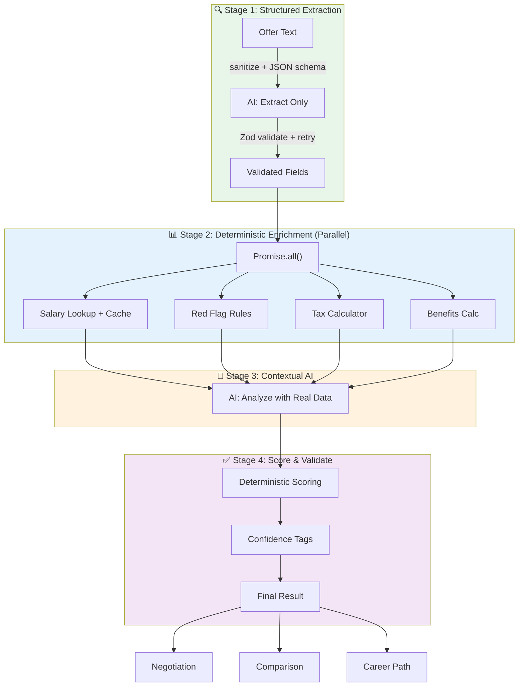
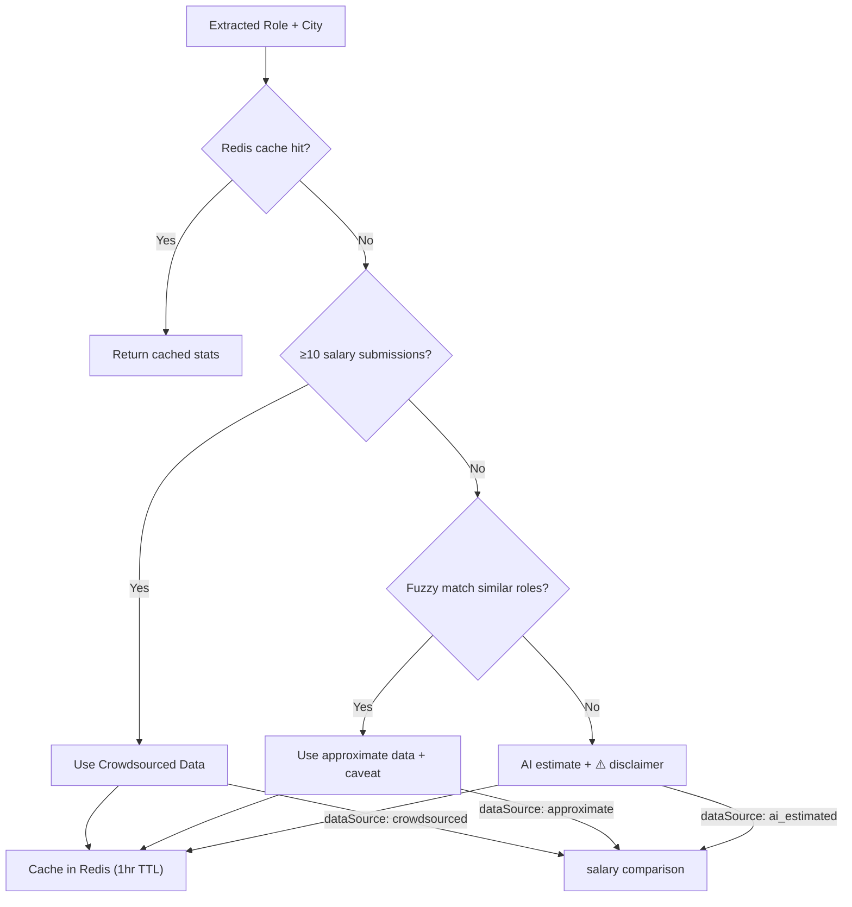
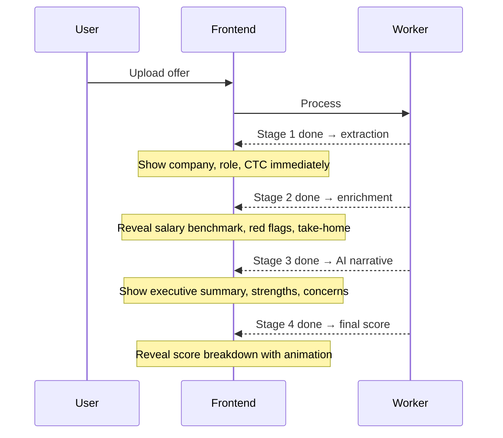

# PLAN: Reliable Analysis Pipeline (All Features)

> **Problem**: The system sends raw offer text to Gemini AI in a single-pass with a vague prompt and blindly trusts the response. Salary data is fabricated, red flags may be hallucinated, scores are arbitrary. Downstream features (negotiation, comparison, career) inherit these problems.

---

## Current System Audit

### Core Analysis Pipeline


| Problem | Where | Impact |
|---------|-------|--------|
| Single vague prompt, no JSON schema | `buildPrompt()` — just says "output compliant JSON" | Inconsistent structure, AI guesses |
| Salary data hallucinated | `salaryComparison` always `ai_estimated` | Users make career decisions on fabricated numbers |
| Crowdsourced salary DB exists but is never used | `SalaryService.getStats()` is functional, never called by analysis | Real data wasted |
| Score formula is trivial | `70 base ± flags ± percentile` in worker | Doesn't reflect actual offer quality |
| Red flag detection is AI-only | No rules engine | Misses obvious flags, invents others |
| No confidence signals | Every field treated as fact | Users can't tell what's reliable vs guessed |

### Feature-Level Problems

| Feature | Current Approach | Problem |
|---------|-----------------|---------|
| **Salary Comparison** | AI fabricates `p25/p50/p75/p90` from training data | 100% hallucinated. `SalaryService` with crowdsourced data exists but is never connected |
| **Negotiation Script** | Feeds AI-hallucinated `salaryComparison` into negotiation prompt | Garbage-in-garbage-out — negotiation points based on fake market data |
| **Benefits Valuation** | ✅ `benefits.calculator.ts` does real math (PTO × daily rate, etc.) | Decent, but depends on AI-extracted benefit names being correct |
| **Offer Comparison** | Deterministic ranking by score/flags/percentile | Good structure, but all inputs (score, percentile) are AI-fabricated |
| **Career Path** | Calls `ai.generateCareerPath()` with hardcoded `industry: 'Technology'`, `companyType: 'Unknown'` | No real context. Completely generic AI generation |
| **Take-Home Estimate** | AI guesses monthly take-home with "assumptions" | Should be deterministic tax math, not AI speculation |

---

## Proposed Architecture: Multi-Stage Pipeline



### Failure Isolation

Each stage produces a result OR a graceful fallback — a single stage failure never blocks the entire pipeline:

| Stage Failure | Fallback | Result |
|---------------|----------|--------|
| Salary lookup fails | AI estimate with `⚠️ AI Estimated` disclaimer | Degraded |
| Rule engine crashes | AI handles all red flag detection | Slightly less reliable |
| Tax calculator fails | Skip take-home section | Core analysis still available |
| Stage 3 AI fails | Return Stage 1 + Stage 2 data without AI narrative | Structured data only |
| Stage 1 extraction fails + retry fails | Fail the job, user can retry with different model | Hard failure |

---

## Stage 1: Structured Extraction (AI → Zod)

**Current**: Single prompt does extraction + analysis + salary comparison + negotiation tips simultaneously.

**Proposed**: Dedicated extraction-only prompt.

- **Sanitize input text** before embedding in prompt — strip control characters, unusual unicode, and prompt-injection patterns
- Use Gemini's **system instruction** (separate from user content) for the extraction schema
- Use Gemini's `responseSchema` parameter to enforce JSON structure at the model level
- Include **2-3 few-shot examples** of annotated extractions for consistency
- Validate output with Zod schema before proceeding
- If validation fails → retry once with validation error feedback
- **Post-extraction sanity checks**: flag suspicious values (CTC > ₹10Cr, CTC < ₹1L for experienced role)
- ~500 tokens per call (fast, cheap)

> [!IMPORTANT]
> **Key principle**: AI extracts what's IN the text. It does NOT analyze, compare, score, or generate salary data. This eliminates hallucination at the source.

**Extracted fields**:
```
├── companyName, role, department, location, industry, companyType
├── compensation (base, variable, equity, components, totalCTC)
├── benefits (name + verbatim value text)
├── dates (joining, offer expiry)
├── terms (notice period, probation, bond, non-compete)
├── restrictive clauses (verbatim quotes)
└── employmentType, currency
```

**Few-shot example structure** (include 2-3 in prompt):
```
EXAMPLE:
Text: "We are pleased to offer you Senior Software Engineer at Infosys, Bangalore. 
       Your annual CTC will be ₹18,00,000..."
Extraction: {"companyName": "Infosys", "role": "Senior Software Engineer", 
             "location": "Bangalore", "compensation": {"totalCTC": 1800000, "currency": "INR"}, ...}
```

---

## Stage 2: Deterministic Enrichment (No AI, Parallel)

All Stage 2 tasks run via **`Promise.all()`** — they're independent and shouldn't block each other.

### 2a. Salary Benchmarking — Real Data

**Current**: AI fabricates `marketRange: { p25, p50, p75, p90 }`.

**Proposed**: Hybrid real data + disclaimer system.



**Implementation details**:
- Wire existing `SalaryService.getStats(role, city)` into analysis worker
- **Fuzzy role matching**: synonym map (`"SDE" ≈ "Software Engineer" ≈ "Software Developer"`)
- **Experience-level filtering**: filter salary submissions by experience bracket, not just role+city
- **Redis caching**: `salary:{role}:{city}` key, 1-hour TTL
- **Minimum sample size**: `n ≥ 10` (raised from 5 for noise resistance)
- Add `dataSource` + `sampleSize` + `dataRecency` fields for UI transparency
- Seed DB with public salary data for bootstrapping

**Data integrity protections**:
- **Statistical outlier detection**: reject submissions >3σ from mean for that role/city
- **Recency weighting**: `weight = 1 / (1 + monthsOld × 0.1)` — older data counts less
- Consider requiring **email verification** for salary submissions

---

### 2b. Red Flag Rule Engine

**Current**: AI decides what's a red flag. May miss obvious ones or hallucinate non-existent ones.

**Proposed**: Pattern-based rules + AI supplement.

| Rule | Pattern | Severity | Type |
|------|---------|----------|------|
| Non-compete | `non-compete`, `restrictive covenant`, `not engage in` | high | `non_compete` |
| Service bond | `bond`, `minimum service`, `lock-in period`, `training cost recovery` | high | `bond` |
| Clawback | `clawback`, `repayment`, `recovery of`, `return of` | high | `clawback` |
| Broad IP assignment | `all intellectual property`, `assign to company`, `work product` | medium | `ip_assignment` |
| Vague compensation | `at discretion`, `may include`, `subject to`, `up to` | medium | `vague_compensation` |
| Probation risk | `terminated without notice during probation` | medium | `probation` |
| At-will clause | `at-will`, `terminate at any time` | low | `other` |
| Missing health insurance | Absence of `health`, `medical`, `insurance` | medium | `missing_benefit` |
| Missing PF/retirement | Absence of `provident fund`, `PF`, `retirement` | low | `missing_benefit` |

- Each rule-flagged issue tagged `source: "rule"` (deterministic)
- AI can still find nuanced issues, tagged `source: "ai"` (with lower confidence)
- UI shows source badge for transparency
- **Prefer `String.includes()` over regex** to avoid ReDoS — use regex only for complex patterns
- **100ms execution timeout** as safety net

---

### 2c. Take-Home Calculator (Indian Tax Regime)

**Current**: AI guesses "monthly take-home: approximately ₹X with assumptions."

**Proposed**: Deterministic calculator for Indian salaries.

| Component | Calculation |
|-----------|-------------|
| Basic salary | From extracted data or 40% of CTC (typical) |
| HRA exemption | min(actual HRA, 50%/40% of basic, rent - 10% of basic) |
| Standard deduction | ₹50,000 |
| EPF employee contribution | 12% of basic (capped at ₹15,000/month) |
| Professional tax | ~₹200/month (state-dependent) |
| Tax (new regime) | Slab-based calculation |
| Tax (old regime) | Slab-based with Section 80C, 80D deductions |

**Output**: Both old and new regime take-home comparisons with breakdown.

---

### 2d. Benefits Calculator (Existing — Enhance)

**Current**: `benefits.calculator.ts` already does PTO valuation, insurance detection, equity categorization. ✅

**Enhancements**:
- Add a **standard benefits checklist** (health insurance, PF, gratuity, leave encashment, WFH allowance, learning budget) — flag missing ones
- Add **industry-standard comparison** (e.g., "most product companies offer 18-24 days PTO, your offer has 12")
- Connect `BenefitBreakdown` totals into the scoring rubric

---

## Stage 3: Contextual AI Analysis

**Current**: AI does everything from scratch with no data.

**Proposed**: AI receives Stage 1 + Stage 2 outputs as context.

The AI prompt now says:
```
SYSTEM INSTRUCTION (separate from user content):
You are an expert compensation analyst. Analyze the following pre-extracted 
and enriched offer data. Do NOT re-extract or invent data — use what's provided.

USER CONTENT:
Here is the extracted offer data (verified from the text):
{extractedData}

Here is the salary benchmark for {role} in {city}:
{salaryComparison — source: crowdsourced/approximate/ai_estimated}

Here are the red flags identified by our rule engine:
{ruleEngineFlags}

Here is the tax-calculated take-home:
{takeHomeBreakdown}

Provide:
1. Executive summary (2-3 sentences)
2. Strengths of this offer
3. Concerns and negotiation leverage points
4. Any additional soft red flags the rules might have missed
5. Industry context for the compensation package
```

**Key design decisions**:
- AI is an *analyst commenting on real data*, not the *data source*
- **Do NOT re-send raw offer text** — only the structured extraction. Saves ~50% tokens
- Use Gemini **system instruction** to isolate analysis instructions from data (prompt injection defense)
- **Token budget**: max ~4K tokens input to Stage 3 (structured data is compact)

### Prompt Versioning

Store prompt template versions in `analysis.aiMetadata` for rollback and A/B testing:

```json
{
  "extractionPromptVersion": "v1.2",
  "analysisPromptVersion": "v1.0",
  "modelUsed": "gemini-2.5-flash",
  "totalTokensUsed": 3847
}
```

---

## Stage 4: Scoring & Validation

### Deterministic Scoring Rubric

**Current**: `score = 70 ± (flags × severity) ± (percentile bump)` — arbitrary.

**Proposed**:

| Component | Weight | Calculation |
|-----------|--------|-------------|
| **Salary Position** | 35% | `offerPercentile` from real salary data → 0-100 |
| **Red Flag Penalty** | 25% | 100 base, deduct per flag: High −20, Med −10, Low −5 |
| **Benefits Completeness** | 20% | % of standard benefits present from checklist |
| **Growth Signals** | 10% | Equity/ESOP, learning budget, title progression, RSU |
| **Transparency** | 10% | Compensation breakdown clarity, no vague terms |

### Confidence Tagging

| Level | Meaning | UI Treatment |
|-------|---------|-------------|
| `high` | Verbatim from offer text | Normal |
| `medium` | AI-inferred from context | 🟡 tag |
| `low` | AI-estimated, no evidence | 🟠 "AI Estimate" badge |
| `unverified` | No ground truth available | 🔴 disclaimer |

---

## Progressive UX (Frontend)

With 4 stages, processing takes longer. Instead of hiding behind a spinner, **stream partial results** as each stage completes:



**Implementation options** (pick one):
- **Option A**: SSE (Server-Sent Events) for real-time stage updates
- **Option B**: Polling `GET /offers/:id` returns `{ stage: 2, partialResults: {...} }`
- **Option C**: Store stage results in DB progressively, frontend polls and renders as data arrives

Option B is simplest and works with existing polling architecture.

---

## Feature Improvements

### 🔄 Salary Comparison (Explorer Page)

| Change | Detail |
|--------|--------|
| **Wire into analysis pipeline** | Analysis worker calls `SalaryService.getStats()` at Stage 2a |
| **Fuzzy role matching** | Synonym map: `"SDE" ≈ "Software Engineer" ≈ "Software Developer"` |
| **Experience-level filtering** | Filter salary submissions by experience bracket, not just role+city |
| **Data quality indicators** | Show sample size (`n=47`) and data recency ("last 6 months") in UI |
| **Seed with public data** | One-time import from public salary datasets to bootstrap |
| **User contribution prompt** | After analysis, ask user to submit their salary anonymously to grow the DB |

---

### 📝 Negotiation Script

| Change | Detail |
|--------|--------|
| **Use real market data** | Pass the real salary benchmark (from Stage 2a) into the prompt |
| **Structured negotiation points** | Rule-engine flags become specific, defensible talking points |
| **Template library** | Pre-built templates for common scenarios (counter-offer, competing offer, relocation) |
| **Tone calibration** | AI receives specific instructions per tone: professional=formal, assertive=data-heavy, friendly=collaborative |
| **Output validation** | Validate script has: greeting, acknowledgment, specific asks with numbers, professional close |
| **Editable output** | Frontend: rich-text editor so user can tweak before sending |

---

### 🏆 Offer Comparison

| Change | Detail |
|--------|--------|
| **Real scores** | Comparison uses deterministic rubric scores (Stage 4), not AI-generated |
| **Dimension-by-dimension breakdown** | Show comparison across each scoring component (salary, benefits, flags, growth, transparency) |
| **AI-generated comparison narrative** | "If you value X, go with Offer A; if you value Y, go with Offer B" |
| **Visual radar chart** | Frontend: radar/spider chart comparing offers across 5 dimensions |
| **Weighted preferences** | Let user set priorities ("salary matters most" vs "benefits matter most") → re-rank |

---

### 🎯 Career Path

| Change | Detail |
|--------|--------|
| **Extract industry + company type** | Stage 1 extraction includes `industry` and `companyType` fields |
| **Company-specific context** | If company is known (e.g., Google, TCS), AI uses company-specific career ladders |
| **Salary progression with real data** | Year 1/3/5 salary ranges from crowdsourced DB filtered by experience level |
| **Skills-to-learn grounded in reality** | AI generates based on actual job market trends, not generic lists |

---

### 💰 Benefits Valuation

| Change | Detail |
|--------|--------|
| **Standard benefits checklist** | Define expected benefits per industry/company-type. Flag missing ones. |
| **Industry comparison** | "Most product companies offer X. Your offer includes/misses Y" |
| **Total comp visualization** | Frontend: stacked bar chart (base + variable + benefits + equity) |
| **User overrides** | Already supported (`overrides` param) — expose in UI |

---

### 💸 Take-Home Calculator (NEW)

| Feature | Detail |
|---------|--------|
| Indian tax calculation | Old vs new regime comparison |
| EPF contribution | Employee + employer |
| HRA exemption | Location-based (metro vs non-metro) |
| Professional tax | State-based |
| Monthly breakdown | Gross → deductions → net |
| What-if scenarios | "What if you negotiate ₹2L more base?" → instant re-calc |

---

## Implementation Phases

### Phase 0: Evaluation Framework (1 day) — Do This First

| # | Task | Why |
|---|------|-----|
| 0a | Collect 15-20 anonymized offer letters as test corpus | Can't improve what you can't measure |
| 0b | Manually annotate ground truth (company, role, CTC, benefits, red flags) | Baseline for accuracy comparison |
| 0c | Build test harness: run extraction → compare vs ground truth → report field-level accuracy | Tracks regression on every change |

**Target metrics**:
- Structured fields (company, role, CTC): > 90% accuracy
- Nuanced fields (benefits, clauses): > 75% accuracy

### Phase 1: Quick Wins (1-2 days)

| # | Task | Impact |
|---|------|--------|
| 1 | Add input sanitization (strip control chars, prompt-injection patterns) | Security |
| 2 | Wire `SalaryService.getStats()` into analysis worker | Real salary data |
| 3 | Add `responseSchema` to Gemini extraction call | Consistent JSON output |
| 4 | Add Zod validation on AI output in worker | Catch malformed responses |
| 5 | Split `buildPrompt()` into extraction vs analysis + few-shot examples | Better accuracy |
| 6 | Pass real salary data into negotiation prompt | Authentic negotiation points |
| 7 | Extract `industry` + `companyType` in Stage 1 | Fix career path context |

### Phase 2: Rule Engine + Tax Calculator (2-3 days)

| # | Task | Impact |
|---|------|--------|
| 8 | Build red flag pattern rule engine (includes > regex, 100ms timeout) | Reliable, deterministic detection |
| 9 | Build Indian tax take-home calculator | Accurate take-home |
| 10 | Implement weighted scoring rubric (5 components) | Fair, auditable scores |
| 11 | Add confidence tags to all output fields | User trust signals |
| 12 | Add standard benefits checklist + missing detection | Complete benefits analysis |
| 13 | Add salary data caching in Redis (1hr TTL) | Performance |

### Phase 3: Full Pipeline Refactor (2-3 days)

| # | Task | Impact |
|---|------|--------|
| 14 | Refactor worker into 4-stage pipeline with `Promise.all()` Stage 2 | Separation of concerns |
| 15 | Add partial failure fallbacks per stage | Reliability |
| 16 | Stage 3: Contextual AI via system instruction (no raw text re-send) | Grounded + secure |
| 17 | Add prompt versioning to `aiMetadata` | Rollback + A/B testing |
| 18 | Progressive results: store stage outputs, poll returns partial data | UX during longer processing |
| 19 | Update comparison to use rubric sub-scores | Dimension-by-dimension |
| 20 | Enhance career path with real context + salary progression | Realistic trajectories |
| 21 | Add negotiation template library | Non-AI fallback |

### Phase 4: Data Flywheel (Ongoing)

| # | Task | Impact |
|---|------|--------|
| 22 | Add fuzzy role matching (synonym map) | Better salary matches |
| 23 | Seed salary DB with public datasets | Bootstrap benchmarks |
| 24 | Salary data poisoning protection (3σ outlier rejection, recency weighting) | Data integrity |
| 25 | Post-analysis salary contribution prompt | Grow crowdsourced data |
| 26 | User correction loop → improve extraction rules | Self-improving system |
| 27 | PII redaction + 90-day raw text retention policy | Compliance |

---

## Before vs After Comparison

| Feature | Before (Current) | After (Proposed) |
|---------|-------------------|------------------|
| **Extraction** | Single mega-prompt, AI guesses schema | Dedicated prompt + `responseSchema` + Zod + few-shot examples |
| **Salary Comparison** | AI hallucinated p25/p50/p75/p90 | Crowdsourced DB → fuzzy match → AI fallback with disclaimer |
| **Red Flags** | AI-only, may hallucinate | Rule engine + AI for nuance, source-tagged |
| **Take-Home** | AI estimated | Deterministic Indian tax calculator (old + new regime) |
| **Score** | `70 ± adjustments` | 5-component weighted rubric (35/25/20/10/10), auditable |
| **Negotiation** | AI script based on fake salary data | AI script grounded in real market data + rule-engine talking points |
| **Comparison** | Deterministic but AI-sourced inputs | Real scores, dimension-by-dimension, weighted preferences |
| **Career Path** | `industry: 'Technology'`, hardcoded | Extracted industry + company context + real salary progression |
| **Benefits** | ✅ Already deterministic | + Standard checklist, industry comparison |
| **Confidence** | None | Per-field confidence with 4 levels + UI badges |
| **Security** | Raw text in prompt | Input sanitization, system instruction isolation, sanity checks |
| **Failure** | All or nothing | Per-stage fallback, partial results |
| **Measurement** | None | Test corpus + field-level accuracy tracking |

---

## Decisions Needed

1. **Phase priority**: Start with Phase 0 (evaluation) + Phase 1 (quick wins), or jump to full pipeline?
2. **Tax calculator scope**: Indian-only for now, or plan for multi-country?
3. **Salary data seeding**: Import a public dataset, or start from scratch with crowdsourced data?
4. **Scoring weights**: Are 35/25/20/10/10 (salary/flags/benefits/growth/transparency) reasonable?
5. **Role synonym map**: Manual mapping or use AI to normalize role names?
6. **Progressive UX approach**: SSE, polling with partial results, or simpler approach?
7. **Frontend scope**: How much UI work in this plan, or keep backend-focused?
