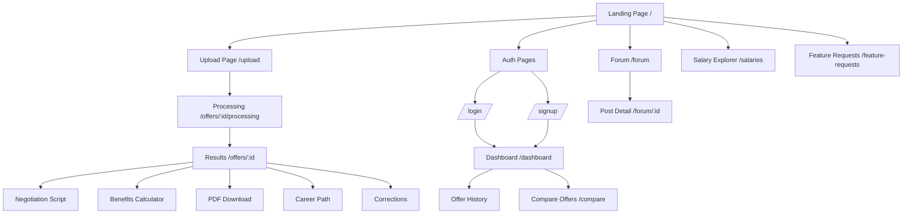
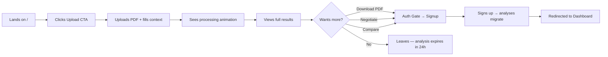
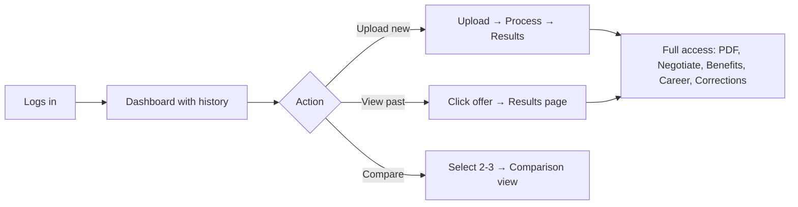
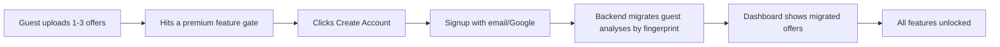

# UI Requirements — Phase 1 (Milestones 1, 2, 3)

> This document defines every screen, user journey, and interaction required for the OfferLens frontend. It covers the **complete Guest → Registered User lifecycle** across all three milestones.

---

## User Personas & Access Model

| Capability | Guest | Registered (Free) |
|---|---|---|
| Upload & Analyze offer | ✅ (3/day, 24h TTL) | ✅ Unlimited |
| View full analysis (score, red flags, salary, tips) | ✅ | ✅ |
| Download PDF report | ❌ | ✅ |
| Analysis history & dashboard | ❌ | ✅ |
| Negotiation script | ❌ | ✅ |
| Benefits calculator | ❌ | ✅ |
| Offer comparison | ❌ | ✅ |
| Corrections (RLHF) | ❌ | ✅ |
| Career path insights | ❌ | ✅ |
| Forum: read | ✅ | ✅ |
| Forum: post/comment | ❌ | ✅ |
| Salary: submit & view stats | ✅ | ✅ |
| Feature requests: submit & vote | ✅ | ✅ |

---

## Sitemap

---

## Screen Specifications

### 1. Landing Page (`/`)

**Purpose**: Convert visitors into uploaders. Zero friction.

**Layout**:
- Hero section with headline: *"Is your offer actually good? Find out in 30 seconds."*
- Single prominent CTA: **"Upload Your Offer Letter"** → navigates to `/upload`
- Secondary text: *"No signup required. Free. Private."*
- Three-step visual: Upload → AI Analyzes → Get Score
- Social proof / stats section (total analyses run, avg score, etc.)
- Feature highlights: Score, Red Flags, Salary Comparison, Negotiation Tips
- Links: Forum, Salary Explorer, Feature Requests

**Interactions**:
- CTA button → `/upload`
- Nav bar: Logo, Upload, Forum, Salary, Login/Signup (or Dashboard if logged in)

**API**: None (static page)

---

### 2. Upload Page (`/upload`)

**Purpose**: Collect offer letter + context for analysis.

**Layout — Two-Step Flow**:

#### Step 1: File Upload
- Drag-and-drop zone with file picker fallback
- Accepted formats: PDF, JPG, PNG, WebP (≤ 10MB)
- *OR* text paste area: "Don't have a file? Paste your offer text"
- File preview thumbnail after selection

#### Step 2: Context Form (shown after file selected)
- **Role/Title** — Autocomplete dropdown (`GET /metadata/roles?q=`)
- **City** — Autocomplete dropdown (`GET /metadata/cities?q=`)
- **Experience Level** — Dropdown (`GET /metadata/experience-levels`)
- **Current CTC** (optional) — Number input with currency selector
- Submit button: **"Analyze My Offer"**

**Interactions**:
- File validation: Show inline error for wrong type/size
- On submit → `POST /offers` (multipart: file + context fields)
- On success → redirect to `/offers/:id/processing`
- Loading state on button during upload

**Error States**:
| Scenario | UI |
|---|---|
| Invalid file type | Inline error: "Please upload a PDF or image (JPG, PNG, WebP)" |
| File too large | Inline error: "File must be under 10MB" |
| Guest rate limited (3/day) | Upload disabled + banner: "You've used all 3 free analyses today. [Create Free Account] for unlimited." |
| Network error | Toast: "Upload failed. Please check your connection and try again." |

**API**: `GET /metadata/roles`, `GET /metadata/cities`, `GET /metadata/experience-levels`, `POST /offers`

---

### 3. Processing Page (`/offers/:id/processing`)

**Purpose**: Show progress while async analysis runs.

**Layout**:
- Animated progress indicator (steps: Uploading → Reading Document → Analyzing → Scoring)
- Each step shows a checkmark when complete
- Estimated time: "Usually takes 15–30 seconds"

**Interactions**:
- Poll `GET /offers/:id` every 3 seconds
- Status transitions: `QUEUED` → `PROCESSING` → `COMPLETED` / `FAILED`
- On `COMPLETED` → auto-redirect to `/offers/:id`
- On `FAILED` → show error with retry option

**Timeout Handling**:
| Duration | UI Change |
|---|---|
| > 30s | "Taking a bit longer than usual…" |
| > 60s | "Still working on it. We'll keep trying." + option to leave and check back |
| > 5min | "Something went wrong. [Try Again] or [Paste Text Manually]" |

**API**: `GET /offers/:id` (polling)

---

### 4. Results Page (`/offers/:id`)

**Purpose**: Present the full AI analysis. This is the core value page.

**Layout — Sectioned Dashboard**:

#### Header
- Offer score badge: large circular gauge (0–100) with color coding (red/yellow/green)
- Company name, role, location (extracted data)
- Score method indicator if fallback: "Estimated score — limited market data"
- OCR confidence warning if low: Yellow banner "We had trouble reading parts of your offer. Some data may be inaccurate."

#### Section A: Salary Comparison
- Your CTC vs Market range (min / median / max) — visual bar chart
- Percentile position: "Your offer is at the 65th percentile"
- Data source label: "Based on 127 verified submissions" or "Estimated — AI-generated range" *(historical example; the shipped wording says "crowdsourced, unverified", see task 5.4 in PLAN-analysis-pipeline.md)*

#### Section B: Red Flags
- Card list, each with:
  - Flag title (e.g., "Non-compete clause")
  - Severity indicator (High / Medium / Low)
  - Matched text excerpt from the offer
  - AI explanation of why it's a concern
- Empty state: "No red flags detected — looks like a clean offer!" ✅

#### Section C: Negotiation Tips
- Bullet list of actionable suggestions
- Each tip: what to negotiate, why, suggested approach
- CTA for registered users: **"Generate Negotiation Email"** → opens negotiation panel

#### Section D: Take-Home Breakdown
- Visual breakdown: Gross → Tax → PF → Net take-home
- Monthly and annual toggle

#### Section E: Benefits Overview
- List of extracted benefits (PTO, insurance, equity, etc.)
- CTA for registered users: **"Calculate Full Benefits Value"** → opens benefits panel

#### Action Bar (sticky bottom or sidebar)
- **Download PDF** (registered only — guest sees lock icon + "Sign up to download")
- **Compare Offers** (registered only)
- **Career Path** (registered only)
- **Correct Data** (registered only)
- **Share** (copy link)

#### Guest Banner (shown only to guests)
- Persistent top banner: "Sign up to save this analysis, compare offers, and get negotiation scripts. [Create Free Account]"
- Soft nudge, not blocking content

**API**: `GET /offers/:id/analysis`

---

### 5. Negotiation Script Panel (`/offers/:id` — drawer/modal)

**Purpose**: Generate a ready-to-send negotiation email.

**Layout**:
- Tone selector: Professional (default), Assertive, Friendly
- Focus areas: Multi-select checkboxes (Salary, Joining Bonus, Benefits, Equity, PTO, etc.)
- Generate button → loading state → rendered script
- Generated script: Formatted email with subject line, body, closing
- Actions: Copy to Clipboard, Download as Text

**Edge Cases**:
| Scenario | UI |
|---|---|
| Offer data too vague | Script with `[PLACEHOLDERS]` + note: "We couldn't extract enough detail. Fill in the bracketed fields." |
| Guest user clicks | Auth gate modal: "Create a free account to generate negotiation scripts" |

**API**: `POST /offers/:id/negotiate`

---

### 6. Benefits Calculator Panel (`/offers/:id` — drawer/modal)

**Purpose**: Quantify all benefits into monetary value.

**Layout**:
- List of detected benefits with AI-estimated values
- Editable override fields for each benefit (user can correct values)
- Total Compensation = Base CTC + Benefits Value
- Visual pie chart of composition

**Edge Cases**:
| Scenario | UI |
|---|---|
| No benefits found | Empty state: "No benefits data found. Your total comp = base CTC." |
| Equity without details | Row: "Equity: Mentioned but not quantifiable" (greyed out) |
| Guest user | Auth gate modal |

**API**: `POST /offers/:id/benefits`

---

### 7. Career Path Panel (`/offers/:id` — drawer/modal)

**Purpose**: Show 5-year career trajectory.

**Layout**:
- Timeline visualization: Year 1 → Year 5
- Each milestone: title, expected salary range, key skills
- Role progression path
- Note if generic: "Showing trajectory for the broader [Industry] field"

**Edge Cases**:
- Guest user → Auth gate modal

**API**: `GET /offers/:id/career-path`

---

### 8. Corrections Panel (`/offers/:id` — drawer/modal)

**Purpose**: Let registered users fix AI extraction errors.

**Layout**:
- Editable form fields for key extracted data (company, role, salary, dates, etc.)
- Highlight what was AI-extracted vs user-corrected
- Submit button: "Save Corrections"
- Success feedback: "Corrections saved. Thank you for improving our AI!"

**API**: `PATCH /offers/:id/corrections`, `GET /offers/:id/corrections`

---

### 9. Auth Pages

#### Login (`/login`)
- Email + Password form
- "Login with Google" button (OAuth)
- "Don't have an account? [Sign Up]" link
- "Forgot password?" link (future)

**API**: `POST /auth/login`, `POST /auth/google`

#### Signup (`/signup`)
- Name (optional), Email, Password form
- "Sign up with Google" button
- "Already have an account? [Login]" link
- On successful signup → guest analysis migration happens automatically
- Redirect to `/dashboard`

**API**: `POST /auth/signup`, `POST /auth/google`

---

### 10. Dashboard (`/dashboard`) — Registered Only

**Purpose**: Central hub for registered users.

**Layout**:

#### Stats Row
- Total analyses count
- Average offer score
- Best offer score
- Active offers count

#### Offer History Table
- Columns: Date, Company, Role, Score, Status
- Sortable by: Date, Score
- Pagination (20 per page)
- Click row → navigate to `/offers/:id`
- Empty state: "No analyses yet. [Upload Your First Offer]"

#### Quick Actions
- "Upload New Offer" button
- "Compare Offers" button (enabled when 2+ completed offers exist)

**API**: `GET /users/me/dashboard`, `GET /users/me/offers?page=&sort=`

---

### 11. Compare Offers (`/compare`) — Registered Only

**Purpose**: Side-by-side comparison of 2–3 offers.

**Layout**:

#### Offer Selector
- Dropdown/cards to select 2–3 completed offers from history
- Disabled selector for offers with status !== `COMPLETED`

#### Comparison Matrix (shown after selection)
- Columns: one per offer
- Rows: Score, Base Salary, Total CTC, Benefits Value, Red Flag Count, Take-Home
- Highlighted winner per row (green)
- AI recommendation summary at bottom: "Based on our analysis, Offer A is stronger because…"

**Edge Cases**:
| Scenario | UI |
|---|---|
| < 2 completed offers | Message: "You need at least 2 completed analyses to compare. [Upload Another Offer]" |
| Selected offer still processing | Offer disabled in selector with badge: "Processing…" |
| Guest user navigates here | Redirect to `/login` with message |

**API**: `POST /offers/compare`, `GET /users/me/offers`

---

### 12. Salary Explorer (`/salaries`)

**Purpose**: Browse and contribute anonymous salary data.

**Layout**:

#### Stats View
- Role selector (autocomplete from metadata)
- City selector (autocomplete from metadata)
- Search button
- Results: Salary range bar chart (min / P25 / median / P75 / max)
- Sample size label: "Based on 127 submissions" or "AI-estimated"
- CTA: "Help improve this data — [Submit Your Salary]"

#### Submit Form (modal/drawer)
- Role, Experience (years), City, Annual CTC, Company Size
- Anonymous badge: "Your submission is fully anonymous"
- Submit → success toast

**Error States**:
| Scenario | UI |
|---|---|
| No data for role+city | "No data yet for this combination. [Be the first to contribute]" |
| Invalid submission data | Inline validation: "Please enter a valid CTC amount" |
| Rate limited | Toast: "Too many submissions. Please try again later." |

**API**: `GET /salaries/stats?role=&city=`, `POST /salaries`, `GET /metadata/roles`, `GET /metadata/cities`

---

### 13. Forum (`/forum`)

**Purpose**: Community discussions about offers, negotiation, careers.

**Layout**:

#### Post List (`/forum`)
- Category filter tabs/dropdown
- Post cards: Title, Author, Date, Comment count
- Pagination
- "New Post" button (registered only)
- Empty state: "Be the first to start a discussion!"

#### Post Detail (`/forum/:id`)
- Post title, body, author, date
- Comments list (chronological)
- Comment input (registered only — guest sees "Log in to comment")

#### Create Post (modal or `/forum/new`)
- Title, Category dropdown, Body (rich text or markdown)
- Submit

**Error States**:
- Spam/profanity → "Your post was flagged. Please rephrase."
- Guest tries to post → Auth gate modal

**API**: `GET /forum/posts?page=&category=`, `GET /forum/posts/:id`, `POST /forum/posts`, `POST /forum/posts/:id/comments`

---

### 14. Feature Requests (`/feature-requests`)

**Purpose**: User-driven product feedback.

**Layout**:
- Request cards: Title, Description, Vote count, Status badge
- Sort: Most Voted, Newest
- Filter by status: Open, Planned, In Progress, Done
- Vote button (toggle) on each card
- "Submit Request" button → modal with Title + Description

**API**: `GET /feature-requests?sort=&status=&page=`, `POST /feature-requests`, `POST /feature-requests/:id/vote`

---

## User Journeys

### Journey 1: Guest (First-Time Visitor)

**Key moments**:
1. **Zero friction upload** — no signup wall before seeing value
2. **Full analysis visible** — score, red flags, salary, tips all shown
3. **Soft upgrade prompts** — premium features show lock icons, not hard blocks
4. **24h TTL reminder** — "This analysis expires in X hours. Sign up to keep it forever."

---

### Journey 2: Registered User (Returning)

**Key moments**:
1. **Dashboard as home** — see all past analyses at a glance
2. **Full feature access** — no gates, all tools available
3. **Multi-offer workflow** — upload multiple, compare, decide

---

### Journey 3: Guest → Registered Migration

**Important**: If 24h TTL has expired before signup, analyses are already purged. User starts fresh.

---

## Global UI Elements

### Navigation Bar
- **Guest**: Logo | Upload | Forum | Salary | Feature Requests | **Login** | **Sign Up**
- **Logged in**: Logo | Upload | Forum | Salary | Feature Requests | **Dashboard** | Profile dropdown (Settings, Logout)

### Auth Gate Modal
Triggered when a guest clicks a registered-only feature.
- Title: "Create a Free Account"
- Body: "Sign up to unlock [feature name], save your analyses, and more."
- CTAs: Email Signup form + Google OAuth button
- "Already have an account? Log in"

### Toast Notifications
- Success: Green — "Analysis complete!", "Corrections saved!"
- Error: Red — "Upload failed", "Network error"
- Info: Blue — "Connecting…", "Retrying…"

### Loading States
- Skeleton screens for data-heavy pages (dashboard, results)
- Shimmer animation on cards during load
- Button spinners during form submissions

### Empty States
| Page | Empty State |
|---|---|
| Dashboard (no offers) | Illustration + "Upload your first offer letter to get started" |
| Forum (no posts) | "Be the first to start a discussion!" |
| Salary stats (no data) | "No data for this combination yet. Be the first to contribute." |
| Red flags (none found) | Green checkmark + "No red flags detected!" |

### Error States
| Scenario | Global Behavior |
|---|---|
| API 500 | Toast: "Something went wrong. Please try again." |
| Network offline | Persistent banner: "You're offline. Reconnect to continue." |
| 401 Unauthorized | Redirect to `/login` with return URL |
| 403 Guest restricted | Auth gate modal |
| 429 Rate limited | Contextual message based on endpoint |

---

## API ↔ Screen Mapping

| API Endpoint | Used On |
|---|---|
| `POST /auth/signup` | Signup page, Auth gate modal |
| `POST /auth/login` | Login page |
| `POST /auth/google` | Login page, Signup page, Auth gate modal |
| `POST /auth/refresh` | Global (token refresh interceptor) |
| `POST /auth/logout` | Nav profile dropdown |
| `GET /users/me` | Global (auth state), Dashboard |
| `GET /users/me/offers` | Dashboard, Compare selector |
| `GET /users/me/dashboard` | Dashboard stats |
| `DELETE /users/me` | Settings (future) |
| `POST /offers` | Upload page |
| `GET /offers/:id` | Processing page (poll), Results page |
| `POST /offers/:id/analyze` | Results page (re-analyze button) |
| `DELETE /offers/:id` | Dashboard (delete action) |
| `GET /offers/:id/analysis` | Results page |
| `GET /offers/:id/report` | Results page (PDF download) |
| `POST /offers/:id/negotiate` | Negotiation panel |
| `POST /offers/:id/benefits` | Benefits panel |
| `GET /offers/:id/career-path` | Career panel |
| `POST /offers/compare` | Compare page |
| `PATCH /offers/:id/corrections` | Corrections panel |
| `GET /offers/:id/corrections` | Corrections panel |
| `POST /salaries` | Salary Explorer (submit form) |
| `GET /salaries/stats` | Salary Explorer (view) |
| `GET /metadata/roles` | Upload page, Salary Explorer |
| `GET /metadata/cities` | Upload page, Salary Explorer |
| `GET /metadata/experience-levels` | Upload page |
| `GET /forum/posts` | Forum list |
| `POST /forum/posts` | Forum new post |
| `GET /forum/posts/:id` | Forum post detail |
| `POST /forum/posts/:id/comments` | Forum post detail |
| `GET /feature-requests` | Feature Requests page |
| `POST /feature-requests` | Feature Requests page |
| `POST /feature-requests/:id/vote` | Feature Requests page |
| `GET /health` | Admin/monitoring (not user-facing) |

---

## Tech Recommendations

> These are suggestions — to be finalized during implementation planning.

- **Framework**: Next.js 14+ (App Router) — SSR for landing/SEO, CSR for app pages
- **Styling**: Tailwind CSS v4
- **State**: Zustand for client state, React Query for server state
- **Auth**: Cookie-based JWT with refresh token rotation
- **Charts**: Recharts or Chart.js for salary/score visualizations
- **PDF Download**: Direct `GET /offers/:id/report` → browser download
- **Polling**: React Query `refetchInterval` for processing status
