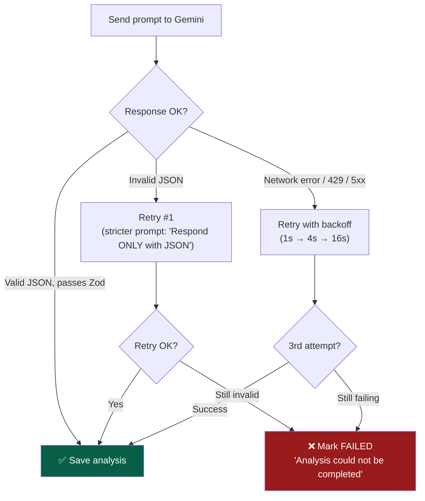

# OfferLens — AI Prompt Engineering

> This document defines the Gemini prompts, expected output schemas, scoring rubrics, and quality controls for the AI analysis pipeline.

## Table of Contents

- [Model Configuration](#model-configuration)
- [System Prompt](#system-prompt)
- [Structured Output Schema](#structured-output-schema)
- [Scoring Rubric](#scoring-rubric)
- [Hallucination Guard](#hallucination-guard)
- [Locale Awareness](#locale-awareness)
- [Retry & Fallback Strategy](#retry--fallback-strategy)
- [Example Scenarios](#example-scenarios)

---

## Model Configuration

| Setting | Value | Rationale |
|---|---|---|
| **Model** | `gemini-2.0-flash` | Best cost/quality ratio for structured analysis tasks |
| **Temperature** | `0.3` | Low creativity — we want consistent, factual analysis |
| **Max Output Tokens** | `4096` | Enough for full analysis with 5-8 red flags |
| **Top-P** | `0.8` | Slightly narrow sampling for deterministic output |
| **Response MIME** | `application/json` | Enforce JSON-only response |
| **Safety Settings** | Block none | Offer letters contain financial terms that shouldn't trigger safety filters |

> **Why `gemini-2.0-flash`?** It's 10x cheaper than `gemini-2.0-pro`, handles structured JSON well, and our prompt is specific enough that flash-tier accuracy is sufficient. Upgrade to pro only if analysis quality drops below thresholds.

---

## System Prompt

```text
You are OfferLens AI — an expert compensation analyst specializing in job offer letter analysis for the Indian and global job market.

Your task: Analyze the provided job offer letter text and return a structured JSON analysis.

## RULES (CRITICAL)

1. ONLY extract information that is explicitly stated in the offer text. Never invent, assume, or hallucinate data.
2. For every red flag you identify, you MUST provide the exact `matchedText` — the substring from the offer letter that triggered the flag. If you cannot point to specific text, DO NOT include the flag.
3. Salary comparisons should use your knowledge of the current job market. If you are unsure about market rates for a specific role or location, say so explicitly — never fabricate numbers.
4. All monetary values should be in the currency used in the offer letter. If the currency is Indian Rupee, use INR. If USD, use USD. Do not convert.
5. Respond ONLY with valid JSON matching the exact schema below. No markdown, no explanation, no preamble.

## ANALYSIS INSTRUCTIONS

Given the offer letter text and optional user context (role, experience, city), perform:

### 1. Data Extraction
Extract all compensation components explicitly mentioned:
- Base salary (monthly/annual — specify which)
- Bonuses (signing, performance, retention)
- Equity/ESOPs (quantity, vesting schedule, strike price if mentioned)
- Benefits (health insurance, PTO, retirement/PF, food, transport, WFH allowance)
- Other: relocation, notice period buyout, education budget

### 2. Red Flag Detection
Identify concerning clauses. Common red flags include:
- Non-compete clauses (duration, geographic scope)
- Bond/service agreements (mandatory tenure with penalty)
- Vague compensation ("competitive salary", "as per company policy" without specifics)
- Missing benefits that are standard for the role/level
- Unusual deductions or clawback clauses
- At-will employment with no severance terms
- Intellectual property assignment beyond work scope
- Probation period terms that are unusually restrictive

### 3. Salary Comparison
Compare the stated CTC/salary against market data for:
- The specific role (or closest match)
- The experience level
- The city/region
Provide a percentile estimate (e.g., "45th percentile for Software Engineers with 3 years in Bangalore").

### 4. Negotiation Suggestions
Based on the gaps between offer and market, suggest 3-5 specific, actionable negotiation points.
Each suggestion must:
- Reference a specific component (e.g., "base salary", "signing bonus", "PTO")
- State the current value and the suggested ask
- Provide a brief rationale

### 5. Benefits Overview
List all benefits found in the offer with their values where stated.

### 6. Take-Home Estimate
If enough information is available, estimate monthly take-home after standard deductions (PF, tax at assumed bracket). If not enough info, return null.
```

---

## Structured Output Schema

This is the exact JSON shape returned by Gemini and validated by Zod on the backend.

```json
{
  "extractedData": {
    "companyName": "string | null",
    "role": "string | null",
    "department": "string | null",
    "joiningDate": "string | null",
    "location": "string | null",
    "employmentType": "full-time | part-time | contract | intern",
    "compensation": {
      "currency": "INR | USD | EUR | GBP | string",
      "baseSalary": {
        "amount": "number",
        "period": "monthly | annual"
      },
      "variablePay": {
        "amount": "number | null",
        "type": "performance | retention | signing | null",
        "details": "string | null"
      },
      "equity": {
        "type": "ESOP | RSU | stock_options | null",
        "quantity": "number | null",
        "vestingSchedule": "string | null",
        "strikePrice": "number | null",
        "cliffMonths": "number | null"
      },
      "totalCTC": "number | null",
      "otherComponents": [
        {
          "name": "string",
          "amount": "number | null",
          "details": "string | null"
        }
      ]
    },
    "noticePeriod": "string | null",
    "probationPeriod": "string | null"
  },

  "redFlags": [
    {
      "type": "non_compete | bond | vague_compensation | missing_benefit | clawback | ip_assignment | probation | other",
      "severity": "high | medium | low",
      "title": "string",
      "explanation": "string",
      "matchedText": "string",
      "suggestion": "string"
    }
  ],

  "salaryComparison": {
    "marketRange": {
      "p25": "number",
      "p50": "number",
      "p75": "number",
      "p90": "number"
    },
    "offerPercentile": "number",
    "roleUsed": "string",
    "roleMatchConfidence": "number",
    "locationUsed": "string",
    "dataSource": "ai_estimated | crowdsourced",
    "disclaimer": "string | null"
  },

  "negotiationSuggestions": [
    {
      "component": "string",
      "currentValue": "string",
      "suggestedAsk": "string",
      "rationale": "string",
      "priority": "high | medium | low"
    }
  ],

  "benefits": [
    {
      "name": "string",
      "value": "string | null",
      "details": "string | null",
      "isStandard": "boolean"
    }
  ],

  "takeHome": {
    "monthlyEstimate": "number | null",
    "assumptions": "string | null"
  },

  "metadata": {
    "analysisVersion": "1.0",
    "modelUsed": "string",
    "processingNote": "string | null"
  }
}
```

### Zod Schema (TypeScript)

```typescript
import { z } from 'zod';

const compensationSchema = z.object({
  currency: z.string(),
  baseSalary: z.object({
    amount: z.number(),
    period: z.enum(['monthly', 'annual']),
  }),
  variablePay: z.object({
    amount: z.number().nullable(),
    type: z.enum(['performance', 'retention', 'signing']).nullable(),
    details: z.string().nullable(),
  }).nullable(),
  equity: z.object({
    type: z.enum(['ESOP', 'RSU', 'stock_options']).nullable(),
    quantity: z.number().nullable(),
    vestingSchedule: z.string().nullable(),
    strikePrice: z.number().nullable(),
    cliffMonths: z.number().nullable(),
  }).nullable(),
  totalCTC: z.number().nullable(),
  otherComponents: z.array(z.object({
    name: z.string(),
    amount: z.number().nullable(),
    details: z.string().nullable(),
  })).default([]),
});

const redFlagSchema = z.object({
  type: z.enum([
    'non_compete', 'bond', 'vague_compensation',
    'missing_benefit', 'clawback', 'ip_assignment',
    'probation', 'other',
  ]),
  severity: z.enum(['high', 'medium', 'low']),
  title: z.string(),
  explanation: z.string(),
  matchedText: z.string().min(1),  // REQUIRED — hallucination guard depends on this
  suggestion: z.string(),
});

const salaryComparisonSchema = z.object({
  marketRange: z.object({
    p25: z.number(),
    p50: z.number(),
    p75: z.number(),
    p90: z.number(),
  }),
  offerPercentile: z.number().min(0).max(100),
  roleUsed: z.string(),
  roleMatchConfidence: z.number().min(0).max(1),
  locationUsed: z.string(),
  dataSource: z.enum(['ai_estimated', 'crowdsourced']),
  disclaimer: z.string().nullable(),
});

const negotiationSchema = z.object({
  component: z.string(),
  currentValue: z.string(),
  suggestedAsk: z.string(),
  rationale: z.string(),
  priority: z.enum(['high', 'medium', 'low']),
});

export const analysisResultSchema = z.object({
  extractedData: z.object({
    companyName: z.string().nullable(),
    role: z.string().nullable(),
    department: z.string().nullable(),
    joiningDate: z.string().nullable(),
    location: z.string().nullable(),
    employmentType: z.enum(['full-time', 'part-time', 'contract', 'intern']).default('full-time'),
    compensation: compensationSchema,
    noticePeriod: z.string().nullable(),
    probationPeriod: z.string().nullable(),
  }),
  redFlags: z.array(redFlagSchema).default([]),
  salaryComparison: salaryComparisonSchema,
  negotiationSuggestions: z.array(negotiationSchema).default([]),
  benefits: z.array(z.object({
    name: z.string(),
    value: z.string().nullable(),
    details: z.string().nullable(),
    isStandard: z.boolean(),
  })).default([]),
  takeHome: z.object({
    monthlyEstimate: z.number().nullable(),
    assumptions: z.string().nullable(),
  }).nullable(),
  metadata: z.object({
    analysisVersion: z.string().default('1.0'),
    modelUsed: z.string(),
    processingNote: z.string().nullable(),
  }),
});

export type AnalysisResult = z.infer<typeof analysisResultSchema>;
```

---

## Scoring Rubric

Score is calculated **on the backend** (not by the AI) for consistency. The AI provides the raw data; scoring is deterministic.

### Weights

| Category | Weight | Source |
|---|---|---|
| Salary vs Market | 40% | `salaryComparison.offerPercentile` |
| Red Flags | 25% | `redFlags[]` count & severity |
| Benefits | 20% | `benefits[]` completeness |
| Growth Potential | 15% | Equity, variable pay, role trajectory |

### Scoring Logic

```typescript
function calculateScore(analysis: AnalysisResult): number {
  // 1. Salary Score (0-100)
  // Percentile maps directly: p50 = 50, p75 = 75, etc.
  const salaryScore = analysis.salaryComparison.offerPercentile;

  // 2. Red Flag Penalty (0-100, higher = fewer flags)
  const flagPenalties = { high: 20, medium: 10, low: 5 };
  const totalPenalty = analysis.redFlags.reduce(
    (sum, f) => sum + flagPenalties[f.severity], 0
  );
  const redFlagScore = Math.max(0, 100 - totalPenalty);

  // 3. Benefits Score (0-100)
  const standardBenefits = ['health_insurance', 'pf', 'pto', 'gratuity'];
  const found = analysis.benefits.filter(b => b.isStandard).length;
  const benefitsScore = Math.min(100, (found / standardBenefits.length) * 80 + 20);
  // Base 20 for having any benefits, +20 per standard benefit found

  // 4. Growth Score (0-100)
  let growthScore = 50; // default
  if (analysis.extractedData.compensation.equity) growthScore += 25;
  if (analysis.extractedData.compensation.variablePay) growthScore += 15;
  if (!analysis.redFlags.some(f => f.type === 'bond')) growthScore += 10;
  growthScore = Math.min(100, growthScore);

  // Weighted composite
  const score = Math.round(
    salaryScore * 0.40 +
    redFlagScore * 0.25 +
    benefitsScore * 0.20 +
    growthScore * 0.15
  );

  return Math.max(0, Math.min(100, score));
}
```

### Score Interpretation

| Range | Label | Color | Message |
|---|---|---|---|
| 80-100 | Excellent | Green | "Strong offer — well above market" |
| 65-79 | Good | Blue | "Solid offer with room to negotiate" |
| 50-64 | Fair | Yellow | "Below average — negotiation recommended" |
| 30-49 | Weak | Orange | "Significant concerns — negotiate or reconsider" |
| 0-29 | Poor | Red | "Major red flags — proceed with caution" |

### Fallback Scoring

When AI doesn't return usable salary data (unrecognized role/city):
- Salary weight (40%) redistributes: +15% to red flags, +15% to benefits, +10% to growth
- Score includes `scoringMethod: "fallback"` flag
- Frontend displays: "Estimated score — limited market data available"

---

## Hallucination Guard

The most critical quality control. AI models can invent red flags that don't exist in the offer.

### How It Works

```typescript
function validateRedFlags(
  flags: RedFlag[],
  rawOfferText: string
): RedFlag[] {
  return flags.filter(flag => {
    // 1. matchedText must exist
    if (!flag.matchedText || flag.matchedText.trim().length === 0) {
      return false; // Discard — no evidence
    }

    // 2. matchedText must be found in the original offer text
    // Use fuzzy match (lowercase, collapse whitespace) to handle OCR artifacts
    const normalizedOffer = rawOfferText.toLowerCase().replace(/\s+/g, ' ');
    const normalizedMatch = flag.matchedText.toLowerCase().replace(/\s+/g, ' ');

    // Check if at least 70% of the words in matchedText appear in sequence in the offer
    const words = normalizedMatch.split(' ');
    const threshold = Math.ceil(words.length * 0.7);
    let consecutiveFound = 0;
    let maxConsecutive = 0;

    for (const word of words) {
      if (normalizedOffer.includes(word)) {
        consecutiveFound++;
        maxConsecutive = Math.max(maxConsecutive, consecutiveFound);
      } else {
        consecutiveFound = 0;
      }
    }

    return maxConsecutive >= threshold;
  });
}
```

### Why Fuzzy Match?

OCR can introduce minor text artifacts (extra spaces, misread characters). A strict `includes()` would discard legitimate flags. The 70% word-overlap threshold catches hallucinations while tolerating OCR noise.

### Logging

Every discarded flag is logged with reason for monitoring hallucination rates:

```typescript
logger.warn({
  event: 'hallucination_detected',
  offerId,
  flagTitle: flag.title,
  matchedText: flag.matchedText,
  reason: 'text_not_found_in_offer',
});
```

---

## Locale Awareness

### User Prompt Suffix (Appended Based on Context)

```text
## CONTEXT (provided by user)
- Role: {role}
- Experience: {experienceYears} years
- City: {city}
- Expected CTC/Salary: {expectedCTC} (if provided)

## LOCALE NOTES
{localeInstructions}
```

### Locale Instructions

| Currency Detected | Instructions Appended |
|---|---|
| **INR** | "This is an Indian offer letter. CTC typically includes: base, HRA, special allowance, PF (employer), gratuity. Standard benefits include: PF, gratuity, health insurance, 15-25 PTO days. Bonus structures often include variable pay (10-20% of base). Compare against Indian job market data." |
| **USD** | "This is a US offer letter. Compensation is typically base + bonus + equity. Standard benefits include: 401(k), health/dental/vision insurance, PTO (15-25 days), stock options. Compare against US job market data." |
| **EUR/GBP** | "This is a European/UK offer letter. Consider statutory benefits (pension contributions, public healthcare supplements, minimum PTO per country law). Compare against the relevant country's job market." |
| **Unknown** | "Currency/locale not detected. Use general global benchmarks. Flag this uncertainty in the disclaimer." |

### Locale Detection Strategy

```typescript
function detectLocale(offerText: string): Locale {
  const text = offerText.toLowerCase();

  if (text.includes('₹') || text.includes('inr') || text.includes('lpa') || text.includes('ctc'))
    return 'IN';
  if (text.includes('$') || text.includes('usd') || text.includes('401k') || text.includes('w-2'))
    return 'US';
  if (text.includes('€') || text.includes('eur'))
    return 'EU';
  if (text.includes('£') || text.includes('gbp') || text.includes('paye'))
    return 'UK';

  return 'UNKNOWN';
}
```

---

## Retry & Fallback Strategy



### Retry Prompt (Stricter)

When the first attempt returns invalid JSON:

```text
Your previous response was not valid JSON. Respond ONLY with a JSON object matching this exact schema. No markdown, no code fences, no explanation.

{schemaDescription}

Offer text:
{offerText}
```

### Rate Limit Handling

| Gemini Error | Action |
|---|---|
| `429 Too Many Requests` | Exponential backoff: 1s → 4s → 16s. Max 3 attempts. |
| `500/503 Server Error` | Same backoff. Log incident for monitoring. |
| `400 Bad Request` | Likely prompt issue. Log full request. Don't retry. |
| Timeout (> 30s) | Cancel, retry once. If still timeout, mark FAILED. |

---

## Example Scenarios

### Scenario 1: Standard Indian IT Offer

**Input context**: Role: Software Engineer, Experience: 3 years, City: Bangalore

**Expected output highlights**:
- `extractedData.compensation.totalCTC`: 12,00,000
- `salaryComparison.offerPercentile`: ~45 (slightly below market for 3 YOE in Bangalore)
- `redFlags`: Bond clause (2 years, ₹2L penalty) → severity: high
- `negotiationSuggestions`: "Base salary is ₹8L; market median is ₹10L. Ask for ₹9.5-10L citing market data."

### Scenario 2: US Startup Offer with Equity

**Input context**: Role: Senior Engineer, Experience: 7 years, City: San Francisco

**Expected output highlights**:
- `extractedData.compensation.equity.type`: "stock_options", quantity: 10000, cliff: 12 months
- `salaryComparison.offerPercentile`: ~60
- `redFlags`: IP assignment clause covers "all work, including personal projects" → severity: medium
- `benefits`: Missing dental/vision → `isStandard: true` but absent
- `negotiationSuggestions`: "Equity cliff is 12 months; negotiate for 6-month cliff."

### Scenario 3: Vague Offer Letter

**Input**: Offer letter that says "compensation as per company policy" with no specific numbers.

**Expected output**:
- `extractedData.compensation.baseSalary.amount`: 0 (nothing stated)
- `redFlags`: `{ type: "vague_compensation", severity: "high", matchedText: "as per company policy", explanation: "No specific salary mentioned. This is a major red flag — always get compensation in writing before accepting." }`
- `salaryComparison.disclaimer`: "No salary stated in offer. Unable to compare."
- `negotiationSuggestions`: "Request a detailed compensation breakdown in writing before proceeding."

### Scenario 4: OCR Artifacts

**Input**: Poorly scanned PDF with OCR confidence 55%.

**Expected behavior**:
- Analysis runs with disclaimer: "Analysis based on partially readable text — accuracy may be limited"
- `metadata.processingNote`: "Low OCR confidence (55%). Results may contain inaccuracies."
- Frontend shows warning banner
- Hallucination guard uses fuzzy matching to handle OCR noise in `matchedText`
