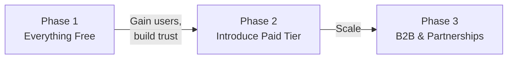

# OfferLens — Monetization Strategy (v4)

## Core Strategy: Free-First, Monetize Later

> **Philosophy**: Give away the full product. Let users fall in love. Monetize only when you've earned the right to charge — and even then, keep the core experience free.

---

## Phase 1: Everything Free (Launch → Traction)

**Goal**: User acquisition, word-of-mouth, product-market fit validation.

Every feature in Phase 1 is **completely free** for all users:

| Feature | Free | Notes |
|---|---|---|
| Upload & OCR | ✅ | PDF, images, up to 10MB |
| Full AI analysis | ✅ | Score, red flags, salary comparison, negotiation tips |
| Offer scoring (0-100) | ✅ | Full composite with breakdown |
| Negotiation tips (bullet points) | ✅ | What to negotiate and why |
| Benefits overview | ✅ | PTO, equity, insurance identified |
| PDF report export | ✅ | **Free forever** — shareable analysis report |
| Feature requests & voting | ✅ | Community-driven roadmap |
| Salary crowdsourcing | ✅ | Submit & view aggregate data |

**Limits** (to prevent abuse, not to monetize):
- **Guest**: ~~3 analyses/day~~ **1 analysis/day**, results expire in 24h
- **Registered**: ~~Unlimited analyses~~ **3 analyses/day**, history saved permanently

> **Superseded (Phase 4, tasks 4.2–4.4):** the owner set guest 1/day and registered 3/day, reset at
> 00:00 IST. Only completed analyses count. Limits live in `backend/src/config/plans.ts`; see
> `PLAN-analysis-pipeline.md` (4.2–4.4 outcome).

**No paywalls. No upgrade prompts. No locked features.** The entire Phase 1 experience is unrestricted for registered users.

---

## Phase 2: Job Hunt Pass (After Traction)

**Goal**: Revenue generation from users who already love the product.

### When to Launch Phase 2

Don't monetize until you hit **at least 2 of these signals**:

| Signal | Threshold |
|---|---|
| Monthly active analyses | 2,000+ |
| Registered users | 1,000+ |
| Returning users (2nd+ visit) | 30%+ |
| Organic referrals | 20%+ of traffic |
| Users requesting premium features | Qualitative signal — forum posts, feature requests |

### What Stays Free (Forever)

| Feature | Status |
|---|---|
| Full analysis (score, red flags, salary, tips) | ✅ Always free |
| PDF report | ✅ Always free |
| Negotiation tips (bullet points) | ✅ Always free |
| Benefits overview | ✅ Always free |
| Analysis history | ✅ Always free (registered) |
| Feature requests & voting | ✅ Always free |
| Forum | ✅ Always free |
| Salary crowdsourcing | ✅ Always free |

### What Becomes Paid (Job Hunt Pass Only)

These are **new Phase 2 features** that get built as premium — existing free features are never taken away.

| Feature | What It Adds Over Free |
|---|---|
| **Polished negotiation email script** | Free shows bullet tips → Pass generates a ready-to-send email with subject, greeting, data-backed points, closing |
| **Offer comparison (side-by-side)** | New feature — compare 2-5 offers in a matrix with recommendation |
| **Career path insights (5-year)** | New feature — AI-generated trajectory with promotions, salary progression |
| **Full benefits calculator (₹ values)** | Free shows overview → Pass quantifies each benefit in ₹ |
| **Priority processing (< 10s)** | Free: standard queue → Pass: skip the queue |
| **Unlimited analyses** | Free: ~~5/month~~ 3/day (superseded by the Phase 4 decision) → Pass: unlimited |

> **Key principle**: No existing free feature ever moves behind a paywall. Paid features are **additions** — polish, depth, and scale on top of what's already free.

### Pricing

| Pass | Price | Duration |
|---|---|---|
| **30-day** | ₹999 (~$12) | Active job hunt |
| **90-day** | ₹1,999 (~$24) | Extended search |
| **Lifetime** | ₹3,999 (~$48) | Early adopters (cap: 500 users) |

### Contextual Affiliate Marketing (Phase 2+)

Low-effort supplementary income. Shown only as **contextual, post-analysis suggestions** — never ads.

| Partner Type | When Shown | Commission |
|---|---|---|
| **Career coaching** (TopResume, The Muse) | Score < 60 or 3+ red flags: "Want 1:1 negotiation help?" | ₹500-1,500/conversion |
| **Negotiation courses** (Udemy, Coursera) | After comparison of 2+ offers: "Go deeper on negotiation" | ₹200-400/sale (20-30%) |
| **Resume builders** (Zety, Novoresume) | Career insights page: "Strengthen your resume for this path" | ₹300-500/signup |
| **Financial tools** (Groww, Kuvera) | High-salary offers: "Plan your investments" | ₹100-200/signup |

**Rules**:
- Only show affiliates that feel like genuine recommendations, not ads
- Never show on the core analysis page — only on secondary pages (career insights, comparison)
- Max 1 affiliate suggestion per page, small and dismissible
- Users never feel like _the product_ — they feel like they're getting a helpful nudge

**Projected affiliate revenue**:

| Phase | Users/mo | Affiliate Revenue | % of Total |
|---|---|---|---|
| Phase 2 (5K users) | 5,000 | ₹10K-45K/mo | ~5-15% |
| Phase 3 (8K+ users) | 8,000+ | ₹30K-85K/mo | ~6-15% |

> Affiliates cover hosting costs and add passive income but are never the primary revenue driver.

---

## Phase 3: B2B & Partnerships (Future)

Only pursue if inbound demand emerges:

| Revenue Stream | Customer | Model |
|---|---|---|
| API licensing | Recruitment agencies, HR platforms | Per-analysis or monthly |
| Salary data licensing | Job boards, research firms | Monthly subscription |

---

## Revenue Projections

| Period | Phase | Users | Pass Revenue | Affiliate | **Total** |
|---|---|---|---|---|---|
| Month 1-6 | Phase 1 (free) | 0 → 2,000 | ₹0 | ₹0 | **₹0** |
| Month 7-9 | Phase 2 launch | 2,000 → 5,000 | ~₹2-3L/mo | ~₹10-30K/mo | **~₹2.5-3.5L/mo** |
| Month 10-12 | Phase 2 growth | 5,000 → 8,000 | ~₹4-5L/mo | ~₹30-85K/mo | **~₹5-6L/mo** |
| **Year 1** | | | | | **~₹25-30L** |

### Costs During Free Phase

| Item | Monthly |
|---|---|
| GCP (Vision + Gemini) | ~₹8 per analysis |
| Hosting | ~₹2,000 |
| Domain + services | ~₹1,500 |
| **At 500 analyses/mo** | **~₹7,500/mo** |
| **At 2,000 analyses/mo** | **~₹19,500/mo** |

> The free phase costs ₹7K-20K/mo. Affiliate income in Phase 2 can offset these costs almost immediately.
