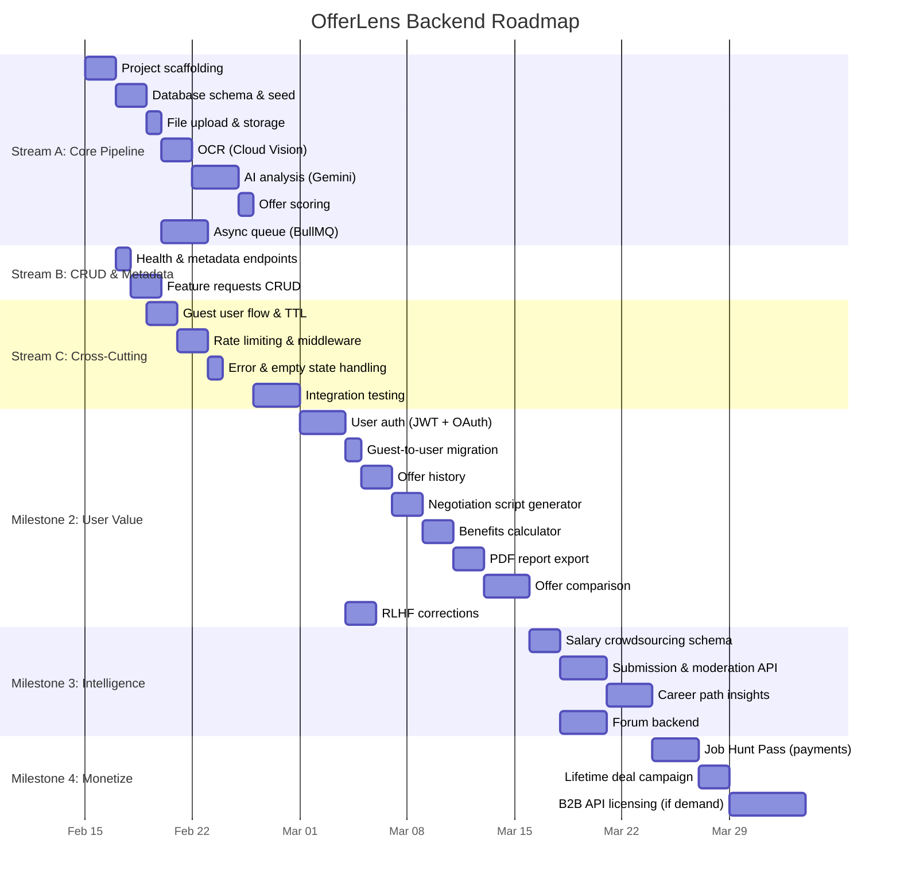
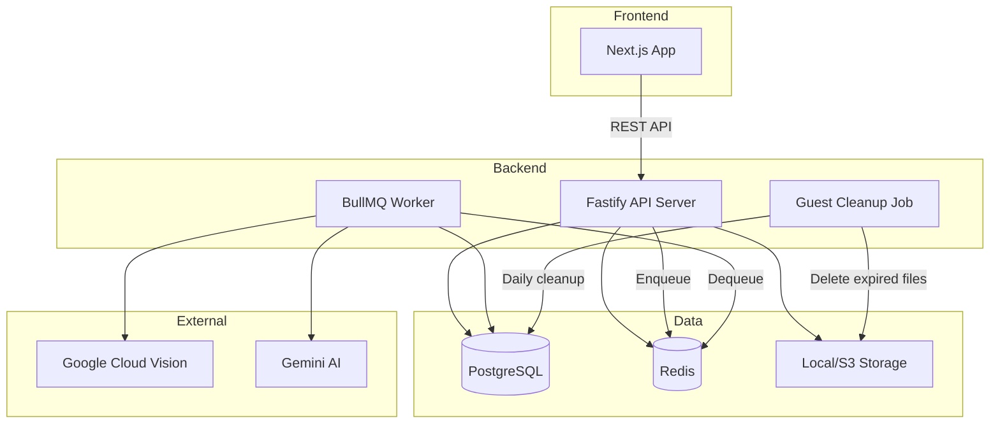

# OfferLens Backend — Product Roadmap

## Problem Statement

Job seekers receive offer letters as opaque PDFs with complex compensation structures, hidden red flags, and no benchmark for whether the package is competitive. Most accept or negotiate blindly. **OfferLens solves this** by using AI to decode, score, and benchmark any offer letter in seconds.

## Target Audience

| Persona | Description | Primary Need |
|---|---|---|
| **Job Seeker** (P0) | Professionals evaluating 1+ job offers | Understand if their offer is fair, spot red flags, negotiate confidently |
| **Recruiter / HR** (P1) | Hiring teams crafting competitive offers | Understand how their offers compare to market and why candidates reject |

---

## MoSCoW Feature Map

### 🔴 MUST — Critical for Launch

| # | Feature | User Story |
|---|---|---|
| M1 | **Offer Upload & OCR** | As a job seeker, I want to upload my offer letter so that the text is automatically extracted |
| M2 | **AI Analysis Pipeline** | As a job seeker, I want AI-powered analysis so that I see red flags, salary comparison, and negotiation tips |
| M3 | **Offer Scoring (0-100)** | As a job seeker, I want a single score so that I can quickly gauge how good my offer is |
| M4 | **Async Processing** | As a job seeker, I want background processing so that I'm not stuck waiting on a loading screen |
| M5 | **Rate Limiting** | As a platform owner, I want abuse prevention so that the service stays reliable |
| M6 | **Metadata APIs** | As a job seeker, I want role/city/experience dropdowns populated from the backend |
| M7 | **Feature Requests** | As a user, I want to submit and vote on feature ideas so that the product evolves based on my needs |
| M8 | **Guest Users** | As a first-time visitor, I want to analyze an offer without signing up so that I can see the value before committing |

#### Access Matrix

| Capability | Phase 1 (Launch — All Free) | Phase 2 (After Traction — Job Hunt Pass) |
|---|---|---|
| Full analysis (score, red flags, salary, tips) | ✅ Free | ✅ Free |
| Negotiation tips (bullet points) | ✅ Free | ✅ Free |
| Benefits overview | ✅ Free | ✅ Free |
| PDF report export | ✅ Free | ✅ **Free forever** |
| Analysis history | ✅ Free (registered) | ✅ Free |
| Feature requests & voting | ✅ Free | ✅ Free |
| Salary crowdsourcing | ✅ Free | ✅ Free |
| Polished negotiation email script | — (not built yet) | 🔒 Pass only |
| Offer comparison (side-by-side) | — (not built yet) | 🔒 Pass only |
| Career path insights (5-year) | — (not built yet) | 🔒 Pass only |
| Full benefits calculator (₹ values) | — (not built yet) | 🔒 Pass only |
| Priority processing (< 10s) | — | 🔒 Pass only |
| Unlimited analyses | ✅ (registered) | 🔒 Pass: unlimited / Free: 5/mo |

> **Principle**: Phase 1 features are free forever. Phase 2 adds new premium features on top — nothing already free moves behind a paywall.

### 🟡 SHOULD — Important, Build Second

| # | Feature | User Story |
|---|---|---|
| S1 | **User Accounts & History** | As a job seeker, I want to save my analyses so that I can revisit them later |
| S2 | **Negotiation Script Generator** | As a job seeker, I want a ready-to-send negotiation email so that I don't have to write one from scratch |
| S3 | **Benefits Calculator** | As a job seeker, I want PTO, insurance, and equity quantified into total comp so that I can compare apples to apples |
| S4 | **PDF Report Export** | As a job seeker, I want to download my analysis as a PDF so that I can share it with mentors or family |
| S5 | **Offer Comparison** | As a job seeker, I want to compare 2-3 offers side-by-side so that I can pick the best one |
| S6 | **RLHF Corrections** | As a user, I want to correct AI mistakes so that future analyses improve |

### 🟢 COULD — Differentiators

| # | Feature | User Story |
|---|---|---|
| C1 | **Salary Crowdsourcing** | As a job seeker, I want to contribute my salary anonymously so that everyone gets better market data |
| C2 | **Career Path Insights** | As a job seeker, I want to see my 5-year trajectory if I accept this role |
| C3 | **Forum** | As a user, I want to discuss salary negotiation strategies with other job seekers |

### ⚪ WON'T (This Version) — Backlog

| # | Feature | Reason |
|---|---|---|
| W1 | Browser Extension | Requires browser-specific development |
| W2 | B2B API Licensing | No demand signal yet; revisit once B2C traction exists |

---

## Milestone Plan

---

## Milestone 1: Foundation MVP

> **Goal**: A guest user can upload a PDF on the frontend, receive a complete analysis with a score within 30s, and is rate-limited after 3/day.

### Definition of Done
- [ ] Guest uploads a PDF → sees complete analysis on results page within 30s
- [ ] All 16 frontend API endpoints return valid responses
- [ ] Rate limiting blocks 4th guest upload with upgrade prompt
- [ ] Guest analysis auto-expires after 24h
- [ ] All integration tests pass, zero unhandled edge cases
- [ ] Error states show user-friendly messages (never raw stack traces)

---

### M1 — Offer Upload & OCR

> As a **Job Seeker**, I want to **upload my offer letter PDF or image**, so that **the system extracts the text automatically**.

**Happy Path**:

> **Given** a user uploads a valid PDF (≤10MB)
> **When** the file is received by `POST /offers`
> **Then** the file is stored, a record is created with status `QUEUED`, and an offer ID is returned

> **Given** a queued offer
> **When** the OCR worker processes it via Google Cloud Vision
> **Then** extracted text is saved to the offer record with a confidence score

**Sad Paths**:

> **Given** a user uploads an unsupported file type (e.g., `.exe`, `.zip`)
> **When** the file is validated
> **Then** a 400 error is returned: `{ code: "INVALID_FILE_TYPE", message: "Please upload a PDF or image (JPG, PNG, WebP)" }`

> **Given** a user uploads a corrupt or empty file
> **When** OCR returns no text or errors
> **Then** the offer is marked `FAILED` with: `"We couldn't read this file. Please try a clearer scan or paste the text manually."`

> **Given** OCR extracts text with confidence < 60%
> **When** results are saved
> **Then** the response includes `lowConfidence: true` and the frontend shows a warning: "We had trouble reading parts of your offer. Please review the extracted text and correct any errors."

> **Given** an extremely large image (>20MP)
> **When** the file is received
> **Then** it is resized to max 4096px before sending to Cloud Vision

---

### M2 — AI Analysis Pipeline

> As a **Job Seeker**, I want to **receive AI-powered analysis of my offer**, so that **I understand red flags, how my salary compares, and what to negotiate**.

**Happy Path**:

> **Given** extracted offer text + user context (role, experience, city, CTC)
> **When** the AI analysis runs via Gemini
> **Then** the response contains: `extractedData`, `redFlags[]`, `salaryComparison`, `negotiationSuggestions[]`, `takeHome`, `offerScore`

> **Given** the AI returns a response
> **When** the response is parsed
> **Then** it strictly matches the expected JSON schema (validated by Zod)

**Quality Thresholds**:

> **Given** OCR confidence < 60%
> **When** the AI analysis runs
> **Then** results include a disclaimer: `"Analysis based on partially readable text — accuracy may be limited"`

> **Given** the role is not in the seeded metadata list
> **When** the AI runs salary comparison
> **Then** it uses the closest AI-matched role, and the response includes `roleMatched: "Software Engineer"` and `roleMatchConfidence: 0.85` so the user knows it's an approximation

> **Given** the city is unrecognized or international
> **When** salary comparison runs
> **Then** the comparison falls back to country-level data with a note: `"City-level data unavailable; using national averages"`

**Sad Paths**:

> **Given** Gemini returns malformed or partial JSON
> **When** Zod validation fails
> **Then** the system retries once with a stricter prompt; if still invalid, marks offer as `FAILED` with: `"Analysis could not be completed. Please try again."`

> **Given** the Gemini API call fails (rate limit, timeout, 5xx)
> **When** the error is caught
> **Then** the offer is retried up to 2 times with exponential backoff; after 3 failures, marked `FAILED` with: `"Our analysis service is temporarily busy. Your offer has been queued and will be processed shortly."`

> **Given** the AI returns a red flag
> **When** the matched text doesn't actually exist in the offer
> **Then** the red flag is discarded (hallucination guard) — only red flags with verified `matchedText` present in the raw text are kept

---

### M3 — Offer Scoring

> As a **Job Seeker**, I want to **see a single 0-100 score for my offer**, so that **I can quickly gauge its quality**.

**Happy Path**:

> **Given** a completed analysis
> **When** the score is calculated
> **Then** it's a weighted composite: salary vs market (40%), red flags penalty (25%), benefits (20%), growth potential (15%)

**Sad Paths**:

> **Given** the AI doesn't return a score
> **When** fallback scoring runs
> **Then** a deterministic score is calculated from available data; the response includes `scoringMethod: "fallback"` so the frontend can show "Estimated score"

> **Given** salary comparison data is unavailable (unrecognized role/city)
> **When** scoring runs
> **Then** the salary weight (40%) is redistributed to other factors, and the score includes a note: `"Score based on limited market data"`

---

### M4 — Async Processing

> As a **Job Seeker**, I want to **not wait on a loading screen**, so that **I can check back when my analysis is ready**.

**Happy Path**:

> **Given** an offer is uploaded
> **When** `POST /offers` returns
> **Then** it responds immediately with `{ id, status: "QUEUED" }` (< 500ms)

> **Given** a queued offer
> **When** the frontend polls `GET /offers/:id`
> **Then** it returns current status (`QUEUED` → `PROCESSING` → `COMPLETED`)

**Sad Paths**:

> **Given** the worker crashes mid-processing
> **When** the job is stale (status = `PROCESSING` for > 5 minutes)
> **Then** a health check marks it as `FAILED` and the user sees: `"Analysis timed out. Please try uploading again."`

> **Given** the Redis queue is down
> **When** `POST /offers` tries to enqueue
> **Then** the system falls back to synchronous processing (slower but functional) and logs an alert

---

### M5 — Rate Limiting

> As a **Platform Owner**, I want to **prevent API abuse**, so that **the service stays available for legitimate users**.

**Happy Path**:

> **Given** a guest user
> **When** they exceed 3 offer uploads per day
> **Then** a 429 response is returned with `{ code: "RATE_LIMITED", message: "Create a free account for unlimited analyses", upgradeUrl: "/signup" }`

> **Given** any user
> **When** they exceed 30 API requests per minute
> **Then** a 429 response is returned with `Retry-After` header

**Sad Path**:

> **Given** a user spoofs the `X-Fingerprint` header to bypass limits
> **When** the same IP is seen with 5+ distinct fingerprints in 1 hour
> **Then** rate limiting falls back to IP-only mode for that IP, and the incident is logged

---

### M6 & M7 — Metadata & Feature Requests

See [implementation_plan.md](file:///C:/Users/Mueen/.gemini/antigravity/brain/42766cda-5c2b-4561-8a05-c7e308845b71/implementation_plan.md) for endpoint specifications.

**Sad Path (Feature Requests)**:

> **Given** a user submits a feature request with profanity or spam
> **When** the request is validated
> **Then** basic keyword filtering rejects it with 400: `"Submission rejected — please rephrase"`

---

### M8 — Guest Users

> As a **First-Time Visitor**, I want to **analyze an offer without creating an account**, so that **I can experience the product's value before signing up**.

**Happy Path**:

> **Given** a visitor with no account
> **When** they upload an offer via `POST /offers`
> **Then** the analysis runs normally, but the offer record is marked `guest: true` with an `expiresAt` timestamp (24 hours from creation)

> **Given** a guest's analysis is complete
> **When** they view the results page
> **Then** they see the full analysis but with a banner: "Sign up to save this analysis and unlock comparison, exports, and negotiation scripts"

> **Given** a guest user who later signs up
> **When** they create an account within the 24-hour TTL window
> **Then** their existing guest analyses (matched by fingerprint) are migrated to their new account and the TTL is removed

**Sad Paths**:

> **Given** a guest user
> **When** they try to access history, PDF export, or offer comparison
> **Then** they receive a 403 with `{ code: "GUEST_RESTRICTED", message: "Create a free account to access this feature" }`

> **Given** a guest user
> **When** they exceed 3 analyses per day
> **Then** a 429 response is returned with message "Create a free account for unlimited analyses"

> **Given** a guest clears cookies and uses a VPN (fingerprint + IP reset)
> **When** they appear as a "new" guest
> **Then** they get 3 more analyses (accepted trade-off — the cost of each analysis is low, and aggressive blocking risks penalizing legitimate users)

> **Given** a guest signs up after the 24h TTL has expired
> **When** account is created
> **Then** the expired analyses are already purged; the user starts fresh (no migration possible)

**Implementation Notes**:
- Guest identity tracked via `X-Fingerprint` header (client-side generated) + IP address
- Offer records store `guestFingerprint` and `expiresAt` fields
- A scheduled BullMQ repeatable job purges expired guest records daily
- Guest analyses are **read-only** — no corrections, no re-analysis

---

### Error & Empty State UX Specs

| Scenario | What the User Sees |
|---|---|
| **First visit, no analyses** | Upload page with hero text: "Upload your first offer letter to get started" — no empty table |
| **Analysis failed (3 retries exhausted)** | Results page shows: "We couldn't analyze this offer. [Try Again] or [Paste Text Manually]" |
| **OCR extracted gibberish** | Warning banner + editable text area: "We had trouble reading your offer. Please review and correct the text below." |
| **All 3 guest analyses used** | Upload page shows: "You've used all 3 free analyses today. [Create Free Account] for unlimited access" — upload button disabled |
| **Network error mid-poll** | Toast: "Connection lost. We'll keep trying…" with auto-retry every 5s |
| **Offer still processing after 60s** | Progress indicator changes to: "Taking longer than usual. We'll notify you when ready." |

---

## Milestone 2: User Value

### Definition of Done
- [ ] Users can sign up (email + Google OAuth), log in, and see their analysis history
- [ ] Guest analyses migrate to new accounts on signup
- [ ] Registered users can generate negotiation scripts, calculate benefits, export PDFs, and compare offers
- [ ] RLHF corrections are saved and logged

---

### S1 — User Accounts & History

> As a **Job Seeker**, I want to **create an account and see my past analyses**, so that **I can revisit and compare offers over time**.

**Happy Path**:

> **Given** a new user
> **When** they sign up via email or Google OAuth
> **Then** an account is created, JWT issued, and they are redirected to dashboard

> **Given** a logged-in user
> **When** they visit their dashboard
> **Then** they see a list of all past offers with status, score, and date

> **Given** a guest who already analyzed offers
> **When** they sign up
> **Then** previous guest analyses (matched by fingerprint) are migrated to their account and persisted permanently

**Sad Path**:

> **Given** a user tries to sign up with an email already in use
> **When** the form is submitted
> **Then** a 409 is returned: `"An account with this email already exists. Did you mean to log in?"`

---

### S2 — Negotiation Script Generator

> As a **Job Seeker**, I want to **get a ready-to-send negotiation email**, so that **I can negotiate confidently without writing from scratch**.

**Happy Path**:

> **Given** a completed analysis with negotiation suggestions
> **When** the user requests a script via `POST /offers/:id/negotiate`
> **Then** Gemini generates a professional email script with: subject line, greeting, 3-4 negotiation points with justification, professional closing

**Sad Paths**:

> **Given** the offer data is too vague (e.g., no salary, no company name extracted)
> **When** the user requests a negotiation script
> **Then** the response includes a generic template with placeholders: "[COMPANY NAME]", "[YOUR TARGET SALARY]" and a note: "We couldn't extract enough detail for a fully personalized script. Please fill in the bracketed fields."

> **Given** a guest user requests a negotiation script
> **When** the endpoint checks auth
> **Then** 403: `{ code: "GUEST_RESTRICTED" }`

---

### S3 — Benefits Calculator

> As a **Job Seeker**, I want **PTO, insurance, equity, and perks quantified in monetary terms**, so that **I can compare total compensation across offers**.

**Happy Path**:

> **Given** extracted offer data with benefits (PTO days, insurance, equity/RSUs)
> **When** the calculator runs
> **Then** each benefit is assigned a monetary value and summed into `totalCompensation`

**Sad Paths**:

> **Given** no benefits info was extracted from the offer
> **When** the calculator runs
> **Then** the response returns `totalCompensation: null` with `message: "No benefits data found in your offer. Your total comp equals your base CTC."` — the benefits section shows an empty state prompting the user to add benefits manually

> **Given** equity is mentioned but without a vesting schedule or strike price
> **When** the calculator runs
> **Then** equity is shown as "Mentioned but not quantifiable" and excluded from the monetary total

---

### S4 — PDF Report Export

> As a **Job Seeker**, I want to **download my analysis as a PDF**, so that **I can share it offline**.

**Happy Path**:

> **Given** a completed analysis
> **When** the user requests `GET /offers/:id/report`
> **Then** a styled PDF is generated with: offer summary, score, red flags, salary comparison, negotiation tips

**Sad Path**:

> **Given** PDF generation fails (rendering library error)
> **When** the error is caught
> **Then** 500: `"Report generation failed. Please try again."` — with fallback option to copy analysis as plain text

---

### S5 — Offer Comparison

> As a **Job Seeker**, I want to **compare 2-3 offers side-by-side**, so that **I can make the best decision**.

**Happy Path**:

> **Given** 2-3 completed analyses
> **When** the user requests `POST /offers/compare` with offer IDs
> **Then** the response includes a comparison matrix with: scores, salary, benefits, red flag count, and a recommendation

**Sad Paths**:

> **Given** one of the selected offers is still `PROCESSING` or `FAILED`
> **When** the comparison is requested
> **Then** 400: `"Offer [id] is not ready for comparison. Status: PROCESSING"` — the frontend disables that offer in the selector

> **Given** a user tries to compare only 1 offer
> **When** the request is validated
> **Then** 400: `"Comparison requires at least 2 offers"`

> **Given** a guest user
> **When** they request comparison
> **Then** 403: `{ code: "GUEST_RESTRICTED" }` — guests must create a free account first

---

### S6 — RLHF Corrections

**Sad Path**:

> **Given** a user submits corrections that are identical to existing data
> **When** the patch is applied
> **Then** the response returns 200 with `{ changed: false }` — no re-analysis is triggered

---

## Milestone 3: Market Intelligence

### Definition of Done
- [ ] Anonymous salary submissions work with moderation (spam/troll filtering)
- [ ] Salary comparison uses crowdsourced data when 50+ data points exist for a role+city combo
- [ ] Career path insights generate meaningful 5-year trajectories
- [ ] Forum supports posting, replying, and viewing with pagination

---

### C1 — Salary Crowdsourcing

> As a **Job Seeker**, I want to **anonymously share my salary**, so that **the community gets better market data**.

**Happy Path**:

> **Given** a user submits salary data (role, experience, city, CTC, company size)
> **When** the submission is saved
> **Then** it is stored anonymously (no PII linkage) and contributes to aggregate market statistics

> **Given** 50+ data points for a role+city combination
> **When** a user analyzes an offer for that combination
> **Then** the salary comparison uses real crowdsourced data instead of AI estimates, with source label: `"Based on 127 verified submissions"`

**Sad Paths & Moderation**:

> **Given** a submission with obviously fake data (e.g., ₹1 CTC, 500 years experience)
> **When** validation runs
> **Then** the submission is rejected with 400: `"The values provided appear invalid. Please double-check your entry."`

> **Given** a burst of 10+ submissions from the same IP in 1 hour
> **When** rate limiting is checked
> **Then** further submissions are blocked: `"Too many submissions. Please try again later."`

> **Given** fewer than 50 data points exist for a role+city combination
> **When** salary comparison runs
> **Then** AI-estimated ranges are used with a label: `"Estimated — not enough submissions yet. [Contribute your salary] to improve accuracy."`

**Data Retention**: Submissions are retained indefinitely but fully anonymized — no linkage to user accounts, IPs, or fingerprints after validation.

---

### C2 — Career Path Insights

> As a **Job Seeker**, I want to see **where this role could lead in 5 years**, so that **I can evaluate long-term value, not just current salary**.

**Happy Path**:

> **Given** a completed offer analysis
> **When** the user requests career insights
> **Then** Gemini generates a 5-year trajectory: typical promotions, salary progression, and skill development for the role+industry

**Sad Paths**:

> **Given** the role is highly niche or unrecognized
> **When** career insights are requested
> **Then** the response includes a generic trajectory for the broader field with a note: `"We don't have specific data for [Niche Role]. Showing trajectory for the broader [Industry] field."`

> **Given** the offer is for a location with very different career norms (e.g., government vs private sector)
> **When** insights are generated
> **Then** the response accounts for sector context in the trajectory

---

### C3 — Forum

**Sad Paths**:

> **Given** a user posts content with profanity or spam links
> **When** the post is validated
> **Then** it is rejected with 400: `"Your post was flagged for review. Please rephrase and try again."`

> **Given** the forum has zero posts
> **When** a user visits the forum page
> **Then** they see an empty state: "Be the first to start a discussion! Share your negotiation experience."

---

## Milestone 4: Monetization (Phase 2 — After Traction)

> **Launch only after hitting traction signals**: 2,000+ monthly analyses, 1,000+ registered users, 30%+ returning users.

### Definition of Done
- [ ] Job Hunt Pass purchase flow works end-to-end (Razorpay/Stripe)
- [ ] New premium features (scripts, comparison, career insights, priority) are gated to pass holders
- [ ] All Phase 1 features remain completely free — no existing feature moves behind a paywall
- [ ] Pass expiry downgrades gracefully (analyses and PDFs remain accessible)

---

### Job Hunt Pass

- **30-day Pass** (₹999): Unlimited analyses, polished negotiation scripts, offer comparison, career insights, full benefits calculator, priority processing
- **90-day Pass** (₹1,999): Everything in 30-day + counter-offer scripts
- **Lifetime Deal** (₹3,999): Everything, forever. Capped at 500 users.

See [monetization.md](file:///C:/Users/Mueen/.gemini/antigravity/brain/42766cda-5c2b-4561-8a05-c7e308845b71/monetization.md) for full pricing strategy, conversion triggers, and revenue projections.

**Sad Paths**:

> **Given** a free user hits their monthly 5-analysis limit (Phase 2 only)
> **When** they try to upload a 6th offer
> **Then** a soft prompt: "You've used your 5 free analyses this month. Actively hunting? Unlock unlimited with a Job Hunt Pass →" — upload is blocked but UI remains friendly

> **Given** a user's Job Hunt Pass expires
> **When** they try to use pass features (scripts, comparison)
> **Then** they are downgraded to free tier; all existing analyses, history, and PDFs remain accessible forever

---

## Privacy & Compliance

| Concern | Policy |
|---|---|
| **Uploaded PDFs** | Deleted from storage after OCR extraction. Only extracted text is retained. |
| **Extracted text sent to Gemini** | Gemini API does not use customer data for model training ([Google policy](https://ai.google.dev/terms)). This is disclosed in the privacy policy. |
| **Right to delete** | `DELETE /offers/:id` permanently deletes the offer, analysis, and any associated files. `DELETE /account` deletes all user data. |
| **Guest data** | Auto-purged after 24h TTL. No PII is stored for guests. |
| **Salary crowdsourcing** | Fully anonymized at submission time — no linkage to user account, IP, or fingerprint after validation passes. |
| **Data retention** | Registered user data retained until account deletion. Anonymized aggregate data (salary stats) retained indefinitely. |
| **GDPR** | Users can request a full data export (`GET /account/export`) or deletion (`DELETE /account`). |

---

## Architecture Overview

---

## Success Metrics

| Metric | Target (M1) | Target (M2) | Target (M4) |
|---|---|---|---|
| Upload → results latency | < 30s | < 25s | < 15s |
| Analysis accuracy (correction rate) | < 30% | < 20% | < 10% |
| Uptime | 99% | 99.5% | 99.9% |
| Daily active analyses | 10+ | 50+ | 500+ |
| Guest → registered conversion | — | 15% | 25% |
| Premium conversion | — | — | 5% of registered |

---

## Risk Register

| Risk | Impact | Likelihood | Mitigation |
|---|---|---|---|
| **Gemini API rate limits** | Analysis delays | Medium | Queue with exponential backoff; fallback to cached market data |
| **AI hallucination** — invents non-existent red flags | User makes bad decisions | Medium | Hallucination guard: verify `matchedText` exists in raw offer text; discard unverified flags |
| **Cloud Vision OCR accuracy on poor scans** | Bad extraction → bad analysis | Medium | Show confidence score; editable text field; "paste manually" fallback |
| **GCP cost overrun** | Unexpected bills | Low | Budget alerts; rate limiting; usage tracking dashboard |
| **Vendor lock-in** — heavy reliance on GCP | Expensive migration | Low | Abstract OCR and AI behind service interfaces; keep prompts portable |
| **Offer format diversity** — Indian vs US vs EU structures | AI misinterprets locale-specific terms | High | Locale-aware prompts; detect currency/format; test with diverse sample offers |
| **Guest abuse** (no auth) | Resource drain | Medium | Fingerprint + IP + cookie tracking; 3/day cap; 24h TTL auto-cleanup |
| **Guest fingerprint spoofing** | Bypasses rate limits | Low | Fall back to IP-only mode if 5+ fingerprints seen per IP/hour |
| **Storage bloat from expired guest files** | Disk/S3 costs | Low | Daily cleanup job deletes expired files + DB records |
| **Scope creep** — 11+ user-selected features | Delays MVP launch | High | Strict milestone boundaries; M1 must ship before any M2 work begins |
| **Low crowdsourced salary data initially** | Unreliable comparisons | High | AI-estimated ranges as fallback; show data source label; incentivize submissions |
